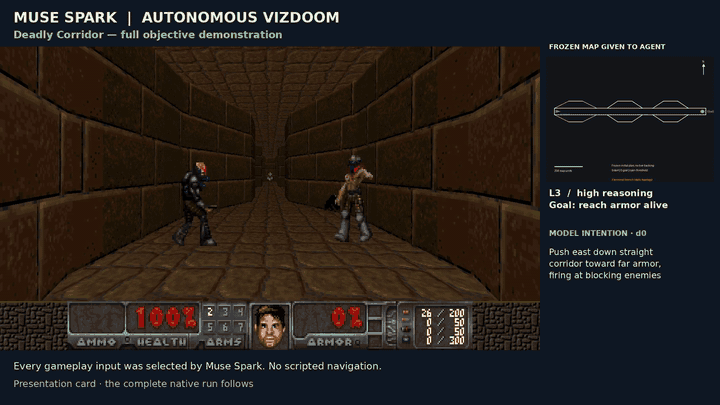
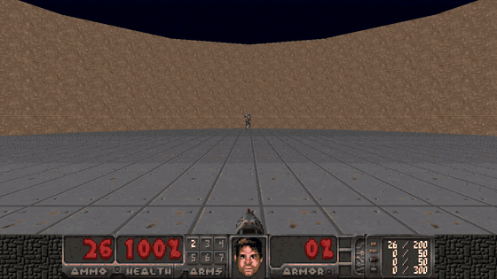
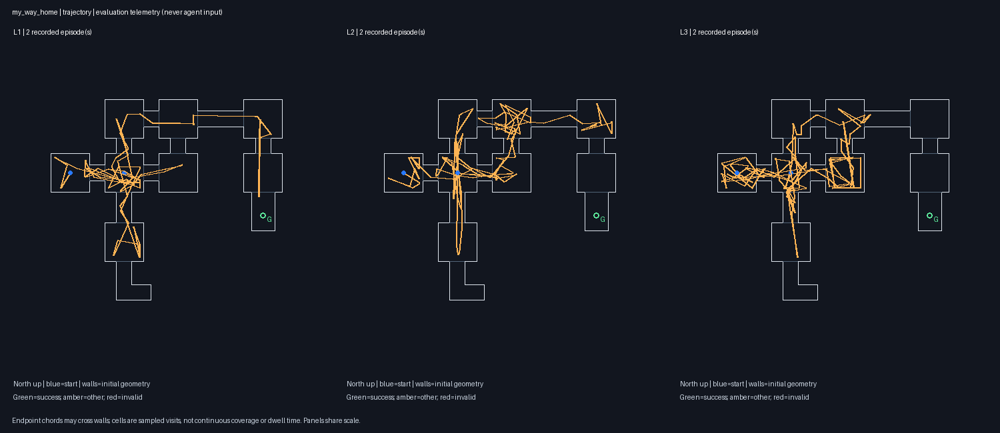
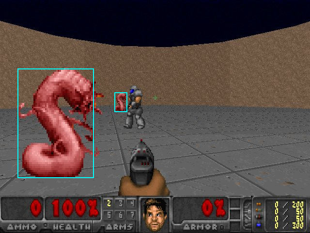
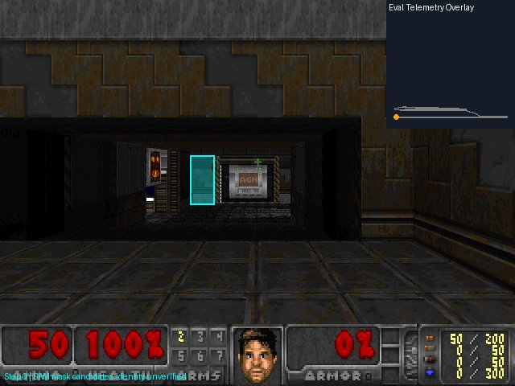

# Generalist Game QA: Autonomous Playtesting with Meta AI

Research on autonomous agents that attempt to complete unfamiliar game levels using progressively richer information, evaluating navigation, progression, and potential gameplay issues through ViZDoom experiments.

## Table of Contents

<details>
<summary><strong>Part I — Project Overview</strong></summary>

- <a href="#project-overview">Project Overview</a>
- <a href="#demo">Demo</a>
- <a href="#technology-overview">Technology Overview</a>
- <a href="#key-findings">Key Findings</a>
- <a href="#quick-start">Quick Start</a>

</details>

<details>
<summary><strong>Part II — Research Motivation</strong></summary>

- [The Problem: AI Has a Reputation Problem](#the-problem-ai-has-a-reputation-problem)

<blockquote>
<details>
<summary><a href="#1-the-creative-industries-are-rejecting-ai">1. The Creative Industries Are Rejecting AI</a></summary>

- [1.1. The consent problem](#11-the-consent-problem)
- [1.2. AO3: scraping, unauthorized reproduction, and AI monetization](#12-ao3-scraping-unauthorized-reproduction-and-ai-monetization)
- [1.3. Publishing: AI allegations now destroy commercial value](#13-publishing-ai-allegations-now-destroy-commercial-value)
- [1.4. Human creators are now paying for AI's reputation](#14-human-creators-are-now-paying-for-ais-reputation)
- [1.5. Scarlett Johansson, creative consent and the right to refuse](#15-scarlett-johansson-creative-consent-and-the-right-to-refuse)

</details>

<details>
<summary><a href="#2-consumers-are-forcing-game-studios-to-reverse-ai-decisions">2. Consumers Are Forcing Game Studios to Reverse AI Decisions</a></summary>

- [2.1. 1666: Amsterdam](#21-1666-amsterdam-production-efficiency-meets-consumer-rejection)
- [2.2. Larian Studios](#22-larian-studios-even-a-respected-developer-was-forced-to-reconsider)
- [2.3. Crimson Desert](#23-crimson-desert-generated-assets-become-a-release-problem)
- [2.4. Crowdfunding: consumers can reject AI before funding it](#24-crowdfunding-consumers-can-reject-ai-before-funding-it)
- [2.5. Epic, Valve, and AI-accelerated development](#25-epic-valve-and-the-cost-of-ai-accelerated-development)

</details>

<details>
<summary><a href="#3-generating-content-is-not-the-same-as-owning-it">3. Generating Content Is Not the Same as Owning It</a></summary>

- [3.1. AI-generated content creates ownership problems](#31-ai-generated-content-creates-ownership-problems)
- [3.2. Needle in a Haystack](#32-needle-in-a-haystack-what-happens-when-code-is-copied)
- [3.3. AI-assisted coding, game cloning, and platform responsibility](#33-ai-assisted-coding-game-cloning-and-platform-responsibility)
- [3.4. More games do not mean more customers](#34-more-games-do-not-mean-more-customers)

</details>

<details>
<summary><a href="#4-game-development-has-a-technical-problem-that-ai-is-not-solving">4. Game Development Has a Technical Problem That AI Is Not Solving</a></summary>

- [4.1. Oblivion Remastered](#41-oblivion-remastered-visual-ambition-without-adequate-performance)
- [4.2. Skyblivion](#42-skyblivion-the-value-of-sustained-human-development)
- [4.3. AI risks accelerating the wrong part of production](#43-ai-risks-accelerating-the-wrong-part-of-production)

</details>

<a href="#5-a-better-use-of-ai-test-human-created-games">5. A Better Use of AI: Test Human-Created Games</a>

<details>
<summary><a href="#6-existing-research-benchmarks-ai-on-gameplay-but-does-that-measure-human-playability">6. Existing Research Benchmarks AI on Gameplay. But Does That Measure Human Playability?</a></summary>

- [6.1. LMGame-Bench](#61-lmgame-bench)
- [6.2. DoomVLM](#62-doomvlm)
- [6.3. SegDoom](#63-segdoom)
- [6.4. The human-playability gap](#64-the-human-playability-gap)
- [6.5. Yellow paint and Marvel's Wolverine](#65-the-yellow-paint-controversy-and-marvels-wolverine-when-accessibility-becomes-excessive-hand-holding)

</details>

<a href="#7-research-questions">7. Research Questions</a>

</blockquote>
</details>

<details>
<summary><strong>Part III — Methodology and Experiments</strong></summary>

- [System Architecture](#system-architecture)
- [Experimental Environment](#experimental-environment)
- [Auto QA Information Levels](#auto-qa-information-levels)
- [Experimental Design](#experimental-design)
- [Results](#results)

</details>

<details>
<summary><strong>Part IV — Discussion and Future Work</strong></summary>

- [Discussion](#discussion)
- [Limitations](#limitations)
- [Future Work](#future-work)
- [References](#references-1)

</details>

## Project Overview

This project investigates the use of generalist AI agents for automated game quality assurance (QA). Using ViZDoom as a controlled experimental environment, the research examines whether multimodal agents powered by Meta AI models can independently navigate unfamiliar game levels, complete objectives, identify potential gameplay issues, and produce actionable feedback for developers.

The proposed framework evaluates agent performance across three progressively richer levels of information:

1. **Level 1 — Blind Play:** The agent receives only the game environment, available controls, and in-game information. It must independently discover the objectives, understand the mechanics, and attempt to complete the level.
2. **Level 2 — Guided Play:** The agent additionally receives information about the game's objectives, rules, and mechanics, allowing it to attempt the level with an understanding of the intended gameplay.
3. **Level 3 — Informed Play:** The agent receives additional structural information, such as a floor plan, navigation map, or level annotations, to evaluate its ability to complete the level with detailed environmental knowledge.

By comparing performance across these conditions, the research aims to distinguish potential problems with discoverability, navigation, and progression from limitations in the agent's own perception and reasoning.

The longer-term objective is to investigate the feasibility of a configurable **Auto QA** system that developers could use to test game levels, review recorded failures, and identify areas requiring further investigation. Such a system could support games developed in conventional engines as well as emerging creation platforms such as Meta Horizon.

## Demo

**L3 autonomous objective completion — Deadly Corridor**



Muse Spark 1.3/high selected all actions in this three-decision completion. The preview includes the complete 2.57-second native gameplay interval, a labeled slow-motion replay, and the recorded result: 100 armor, 40 health. **No `locate` or SAM calls occurred in this episode.** See the [recording and decision audit](docs/m35-results.md#l3high-corridor-demo--completed-objective).

**Autonomous combat — arena, 00:00–00:07**



This excerpt shows model-selected combat from a separate L2 run with six recorded kills. The run later exhausted its budget without completing the survival objective. Both previews use existing recordings; API waiting time is absent from native game time. [Clip provenance and limitations](docs/m35-results.md#submission-readme-previews) describe the display conversions.

Public demo-video link: to be added.

## Technology Overview

| Component | Technology |
|---|---|
| Runtime and setup | Python 3.12, `uv`, locked dependencies; developed in WSL/Linux |
| Game environment | ViZDoom 1.3.2, headless gameplay with 640×480 RGB observations |
| Gameplay agent | Meta Muse Spark 1.3 through the Meta Model API; model-selected actions and tool calls |
| Visual grounding | Meta SAM 3.1; experimental Muse-generated boxes followed by SAM segmentation |
| API client | Responses API at `https://api.meta.ai/v1`; the `openai` Python package is used only as the client. All runtime AI models are Meta models. |
| Records and replay | JSON/JSONL telemetry, screenshots, native ViZDoom `.lmp` recordings, and H.264 MP4 export |
| Validation | `pytest` for integration and information-boundary checks; Ruff for lint and formatting |

## Key Findings

- **Autonomous completion has been observed:** one L3 `my_way_home` run collected the armor and completed the level in 42 decisions. Model-written map plans, the recorded trajectory, and native replay support this result; repeatable success and a causal benefit from the map remain unestablished.
- **Grounding remains experimental:** M0 text-guided SAM returned no masks on 100 Doom prompts. In M2's paired evaluation, Muse-box → SAM hit 10/21 positive cases but also produced 2/7 false positives. A returned mask is a candidate, not a verified object identity.
- **More guidance did not consistently improve navigation:** the ledger/cycle follow-up still produced no wins; the latest L2 retest cost more and explored fewer coarse cells than its baseline. Repeated local navigation remains a significant failure mode.

| Milestone | Implemented and observed | Detailed evidence |
|---|---|---|
| **M0 — Feasibility** | API/tool loop and replay established; known-box segmentation worked, text-only Doom localization did not. | [Spike](docs/spike-results.md) |
| **M1 — Pilot** | Real autonomous gameplay, telemetry, native recording and MP4 replay; no level completion in the validation runs. | [M1](docs/m1-results.md) |
| **M2 — Grounding and information levels** | Candidate grounding, L1/L2/L3 boundaries, ledger and navigation intentions; one verified L3 maze completion. | [M2 navigation](docs/m2-navigation-review.md) |
| **M3 — Metrics and paired sweeps** | Metrics, comparisons and heatmaps implemented; early-stopped sweep completed six runs with **0/6 wins**. | [M3](docs/m3-results.md) |
| **M3.5 — Combat** | Four varied combat profiles tested; later L3/high Corridor attempt completed its armor objective. Arena and Freedoom objectives remained incomplete. | [M3.5](docs/m35-results.md) |
| **M4 — Evidence-backed QA** | Reviewer, trace verifier, reports and carry-over implemented; one controlled fault observation confirmed, two valid carry-over pairs gave no completion improvement. | [M4](docs/m4-results.md) |

See [Results](#results) for the comparisons and links to the experiment reports.

## Quick Start

This is a local command-line research workflow: run an autonomous episode, export its recording, then inspect offline metrics and QA evidence. Each stage is invoked separately. The examples below do not launch a sweep or automatically call the post-episode Reviewer.

**1. Install and configure.**

Use a WSL/Linux shell with Git and [`uv`](https://docs.astral.sh/uv/getting-started/installation/) installed. From a fresh checkout:

```bash
git clone https://github.com/Ramsi-K/vizdoom-agent-research.git
cd vizdoom-agent-research
uv python install 3.12
uv sync --locked --python 3.12
[ -f .env ] || cp .env.example .env
```

Set `MODEL_API_KEY` in `.env` to your Meta Model API key; the existing `META_MODEL_API_KEY` name is also supported. `.env` and generated runs are ignored by Git. Keep credentials out of committed files.

Check the available commands without making API calls:

```bash
uv run --locked autoqa --help
```

**2. Run one autonomous episode.**

Choose one of the following commands. Each starts a separate episode and makes **paid Meta API requests**. These examples use the M2 retest settings: Muse Spark 1.3, low reasoning effort, seed 101, a 60-decision limit, and a USD 0.60 stop threshold per episode. They exercise the agent; they do not guarantee level completion or reproduce the high-reasoning combat demo.

```bash
# L1: blind play
uv run --locked autoqa run --scenario my_way_home --level 1 --seed 101 \
  --model muse-spark-1.3 --effort low --max-decisions 60 --max-usd 0.60

# L2: objective/mechanics briefing and grounding-guided navigation
uv run --locked autoqa run --scenario my_way_home --level 2 --seed 101 \
  --model muse-spark-1.3 --effort low --max-decisions 60 --max-usd 0.60

# L3: briefing, static map, and explicit map-based planning
uv run --locked autoqa run --scenario my_way_home --level 3 --seed 101 \
  --model muse-spark-1.3 --effort low --max-decisions 60 --max-usd 0.60
```

The default grounding mode is experimental `muse_box_sam`; `--grounding-mode sam_text` selects direct text-guided SAM. The cost threshold is checked after response usage arrives, so a final response can exceed it; unknown charges for timed-out requests are not included in recorded totals.

**3. Export the recorded gameplay.**

Each episode creates `runs/<timestamp>_<scenario>_L<level>_s<seed>/`. Set `RUN_DIR` to the directory for the episode you want to replay:

```bash
RUN_DIR="runs/<timestamp>_my_way_home_L3_s101"
uv run --locked autoqa replay "$RUN_DIR"

# Export gameplay only to a separate file, preserving the first export
uv run --locked autoqa replay "$RUN_DIR" \
  --no-outcome-ending --output-name replay-raw.mp4
```

Replay writes `replay.mp4` and replay metadata from the native recording, without model calls. Successful full exports include a labeled slow-motion recap and result hold after the recorded gameplay. Runs and videos stay local under `runs/`; they are not included in a fresh clone.

**4. Inspect offline metrics and QA evidence.**

Use the same `RUN_DIR` and fresh output paths:

```bash
uv run --locked autoqa metrics "$RUN_DIR" --out results/quickstart-metrics.json
uv run --locked autoqa report "$RUN_DIR" --out results/quickstart-report
```

Open `results/quickstart-report/report.html` locally. These commands use saved records and make no model calls. The report checks inline issue candidates against the trace and includes available trajectories, grounding evidence and clips; it does not create new model-written findings or establish that a game defect exists. Missing measurements and evidence remain unavailable.

For paired sweeps, combat profiles, opt-in paid Reviewer analysis and carry-over studies, use the protocols in [M3](docs/m3-results.md), [M3.5](docs/m35-results.md), and [M4](docs/m4-results.md). Developer validation commands remain documented in the [implementation specification](docs/04-implementation.md).

# Part II — Research Motivation

## The Problem: AI Has a Reputation Problem

The creative industries are experiencing growing resistance to generative AI. Artists are challenging the unauthorized use of their work in model training. Writers are discovering their work reproduced and monetized without permission. Game developers are facing consumer backlash over AI-generated assets, while publishers are withdrawing books amid allegations of AI-assisted writing.

The consequences extend beyond companies adopting generative AI. Human artists increasingly face accusations of using AI and demands to demonstrate their creative processes.

**AI's reputation has deteriorated so badly that even genuinely human-created work is becoming suspect.**

The technology industry continues to promote generative AI through promises of faster production and lower costs. These calculations frequently overlook the commercial consequences of replacing creative labor and disregarding consumer expectations.

Executives can decide how their products are developed. Consumers decide whether those products deserve their money.

**Consumer resistance has become a commercial constraint on AI adoption, influencing development decisions, publishing contracts, crowdfunding campaigns, and purchasing behavior.**

Meanwhile, the games industry faces persistent technical challenges. Major releases continue to suffer from poor optimization, unstable frame rates, crashes, progression bugs, and inadequate testing. These problems affect the quality of games, the experience of players, and the commercial prospects of developers.

AI offers substantial opportunities to address these challenges through automated testing, performance analysis, debugging, and gameplay evaluation.

**The games industry has an opportunity to direct AI investment toward improving the quality, reliability, and playability of human-created games.**

This project investigates that opportunity through autonomous gameplay testing in ViZDoom using Meta AI models. It examines whether agents can navigate unfamiliar environments, recognize gameplay failures, improve through structured feedback, and produce reproducible observations that developers can use to investigate technical problems.

A central challenge is determining how effectively AI gameplay observations reflect the experiences of human players. An agent may successfully complete an environment that human players find confusing, or struggle with interactions that humans understand intuitively. Completion rates alone provide limited evidence of human playability.

The research therefore examines both autonomous agent performance and the usefulness of its observations for evaluating gameplay.

**The objective is to establish whether AI agents can contribute meaningful, actionable evidence that helps developers build better games.**

## 1. The Creative Industries Are Rejecting AI

### 1.1. The consent problem

Generative AI's reputation crisis begins with how the technology was developed and commercialized.

Large-scale collection of online writing, artwork, and other creative material has allowed companies to train systems capable of producing competing content. Creators have challenged the use of their work without permission, attribution, or compensation.

The result is an industry selling automated creative production while many of the people whose work helped enable that automation object to the arrangement.

The backlash is therefore not reducible to a dislike of new technology. It concerns who owns creative work, who profits from it, and who gets replaced.

**A technology that promises to eliminate the cost of human creativity should not be surprised when creative communities reject it.**

### 1.2. AO3: scraping, unauthorized reproduction, and AI monetization

The November 2026 Archive of Our Own controversy illustrates what happens when creative work is treated as freely extractable material.

While AO3 was unavailable following a security incident, unauthorized mirror sites surfaced containing millions of fanfiction works.

One site, **ao3.life**, reproduced authors' stories without their permission and attempted to monetize them through AI-generated audiobooks. Reports described deleted and restricted works appearing on mirror sites, along with concerns about authors being asked to provide personal information to request removal.

The site reportedly claimed that audiobook revenue would be shared with authors—despite those authors never having authorized the commercial use of their writing.

The site's operator eventually took it offline following backlash.

The underlying issue is unmistakable: writers contributed their work to a particular community under particular conditions. Someone else copied that work, repackaged it using AI, and attempted to turn it into a commercial product.

AI made the proposed monetization scalable. It did not provide consent.

The incident also exposed a broader problem: authors were expected to discover unauthorized copies of their own work and request removal individually.

**Creative ownership was effectively reversed. The person copying the work acted first; the creator was left to object afterward.**

References:
- [The Mary Sue, November 3, 2026 — AO3 clone sites repost authors' work without consent](https://www.themarysue.com/while-ao3-is-down-fanfiction-clone-sites-are-reposting-authors-work-without-consent-and-one-was-even-selling-ai-audiobooks/)
- [Kotaku — AO3 outage and unauthorized AI audiobooks](https://kotaku.com/a-scam-website-is-trying-to-cash-in-on-ao3-outage-by-selling-audiobooks-of-fanfics-2000752419)

### 1.3. Publishing: AI allegations now destroy commercial value

The publishing industry provides several examples of AI suspicion carrying immediate financial and reputational consequences.

**Mia Ballard — *Shy Girl***

In March 2026, Hachette cancelled the US publication of *Shy Girl* and withdrew the UK edition following allegations of AI-generated writing.

The allegations had spread through Goodreads, Reddit, and YouTube. Ballard denied personally using AI to write the book and attributed any AI involvement to someone she had hired to work on an earlier edition.

Regardless of that dispute, the commercial outcome was decisive: the publisher withdrew the book.

Reference: [The Guardian, March 20, 2026 — Hachette pulls *Shy Girl* after suspected AI use](https://www.theguardian.com/books/2026/mar/20/hachette-horror-novel-shy-girl-suspected-ai-use-mia-ballard)

**H. M. Wolfe — *Daggermouth***

*Daggermouth* became a commercial success and attracted a major publishing deal before allegations of AI-assisted writing became a prominent part of its public discussion.

Research reported by *The Atlantic* identified substantial indicators of AI involvement. Wolfe denied using generative AI.

The controversy demonstrates that even a commercially successful novel can become defined by questions about how it was produced rather than what readers experienced.

Reference: [The Atlantic, July 2026 — Is This What Comes After AI Slop?](https://www.theatlantic.com/technology/2026/07/daggermouth-novel-bestseller-ai/688067/)

**Thélyson Orélien — *C'était ça ou mourir***

In October 2026, Canadian publisher Boréal ended its relationship with Orélien after an investigation found AI-related metadata in manuscript documents.

Orélien denied using AI to write the novel. The publisher said it could not establish the precise extent of AI involvement, but concluded that AI had been used during the writing process.

The dispute followed the novel's literary recognition and generated significant public controversy.

Reference: [The Guardian, October 22, 2026 — Canadian publisher ends relationship with novelist over alleged AI use](https://www.theguardian.com/culture/2026/oct/22/canadian-publisher-boreal-ends-relationship-author-thelyson-orelien-over-ai)

These are not identical cases. They involve different evidence, allegations, responses, and outcomes.

But collectively, they demonstrate a substantial change in the market.

**AI involvement is no longer automatically perceived as an efficiency advantage. It can become a reason for publishers to withdraw support and consumers to question the legitimacy of a product.**

And suspicion alone can have consequences before authorship is conclusively established.

### 1.4. Human creators are now paying for AI's reputation

The backlash has reached a particularly damaging stage: creators who do not use generative AI are being accused of doing so.

In June 2025, *The Guardian* documented independent game developers facing allegations that their human-created artwork was AI-generated.

The developer of *Little Droid*, Stamina Zero, responded by obtaining preliminary sketches and Photoshop files from the artist and publishing evidence of the artwork's creation.

Some critics remained unconvinced.

Another developer faced similar accusations over commissioned artwork.

This is an extraordinary burden to place on creators. An artist completes original work, and instead of discussing its artistic merit, the audience demands proof that a human made it.

The reputation damage caused by irresponsible AI adoption has spread to people who never adopted it.

**When human artists must defend their work against accusations of being AI-generated, the technology has become a liability for the entire creative market.**

Reference: [The Guardian, June 26, 2025 — Game developers accused of using AI even when they aren't](https://www.theguardian.com/games/2025/jun/26/video-game-developers-using-ai-even-when-they-arent-stamina-zero)

### 1.5. Scarlett Johansson, creative consent and the right to refuse

In May 2024, Scarlett Johansson publicly challenged OpenAI over its *Sky* voice for ChatGPT.

Johansson stated that OpenAI CEO Sam Altman had previously approached her about providing a voice for the product. She declined. When OpenAI subsequently demonstrated Sky, Johansson believed the voice sounded strikingly similar to her own. Altman's contemporaneous reference to *Her*, the film in which Johansson voiced an artificial intelligence, intensified the controversy.

Johansson sought legal advice and demanded an explanation. OpenAI suspended Sky.

OpenAI denied imitating Johansson and maintained that Sky belonged to a different voice actress. Subsequent reporting indicated that the actress had been selected before OpenAI approached Johansson. **Deliberate voice cloning was therefore not established.**

Nevertheless, the commercial consequence was clear: a prominent creator publicly challenged an AI product over consent and resemblance, and the company withdrew the contested feature.

The episode demonstrates why creative consent cannot be treated as an inconvenience to be resolved after deployment. Even where infringement is disputed, ignoring objections can produce reputational damage, legal scrutiny, and product reversals.

**References**

- [Reuters — Scarlett Johansson says OpenAI chatbot voice is eerily similar to hers (May 2024)](https://www.reuters.com/technology/scarlett-johansson-says-openai-chatbot-voice-eerily-similar-hers-2024-05-21/)
- [TechCrunch — Scarlett Johansson says OpenAI approached her to use her voice (May 2024)](https://techcrunch.com/2024/05/20/scarlett-johansson-says-that-openai-approached-her-to-use-her-voice/)
- [OpenAI — How the voices for ChatGPT were chosen](https://openai.com/index/how-the-voices-for-chatgpt-were-chosen/)

## 2. Consumers Are Forcing Game Studios to Reverse AI Decisions

Game development is an especially important battleground because it combines visual art, writing, music, voice acting, animation, and interactive design.

Replacing any of these disciplines with generated content affects the product players are being asked to purchase.

The industry has already produced concrete examples of consumer resistance changing development decisions.

### 2.1. *1666: Amsterdam*: production efficiency meets consumer rejection

In June 2026, Panache Digital Games faced backlash after players identified AI-generated artwork in the prologue of *1666: Amsterdam*.

The studio confirmed that AI-generated assets had entered the public demo and marketing materials.

Creative director Patrice Désilets subsequently explained the production advantage: AI could generate 75 visual variations in seconds, something that could not be achieved through equivalent human illustration work in the same time.

That statement exposes the economic attraction of generative AI to studio leadership.

Human creative labor takes time. Generative AI promises an inexpensive shortcut.

But players were not impressed by the efficiency argument.

Following the backlash, Panache apologized and committed to replacing the generated artwork with human-created assets.

By August 2026, Désilets confirmed that the studio had removed generative AI from its development process and would stop using it.

**The studio adopted AI because it was convenient. Consumers objected. The studio reversed course.**

That is the commercial reality AI adoption strategies must confront.

The people controlling production budgets can decide that replacing creative work is efficient. The people purchasing the finished product can decide that the resulting game is no longer worth supporting.

And when the studio must commission replacement artwork, revise its pipeline, and repair public trust, the original cost savings become considerably less convincing.

References:
- [GamesRadar+, June 2026 — Panache apologizes for AI-generated assets](https://www.gamesradar.com/games/action/1666-amsterdam-dev-apologizes-for-ai-in-prologue-demo-says-full-game-will-not-include-any-assets-generated-by-ai/)
- [GamesRadar+, August 2026 — Désilets explains AI production efficiency and asset replacement](https://www.gamesradar.com/games/action/with-gen-ai-assets-cut-from-assassins-creed-creators-new-game-demo-lead-admits-we-didnt-even-realize-it-was-ai-anymore-because-we-were-used-to-seeing-it/)
- [GamesRadar+, August 2026 — Studio confirms it will stop using AI](https://www.gamesradar.com/games/action/after-ai-backlash-assassins-creed-creator-says-1666-amsterdam-wont-be-using-any-ai-anymore-and-only-used-it-in-conception-and-pre-production/)

### 2.2. Larian Studios: even a respected developer was forced to reconsider

Larian Studios, developer of *Baldur's Gate 3*, encountered a similar backlash after CEO Swen Vincke discussed using generative AI to explore ideas, prepare presentations, produce concept-art references, and generate placeholder text during development of *Divinity*.

Players and developers objected.

In January 2026, Larian publicly committed to excluding generative AI from concept-art development.

Vincke stated that *Divinity* would not contain generative AI artwork and that the studio would refrain from using it during concept-art development to eliminate doubt.

This was a significant reversal because the studio had already argued that AI could improve internal workflows.

Larian retained an interest in exploring AI for other development tasks, but consumer pressure established a boundary around creative production.

**Even a highly respected studio could not simply declare its AI workflow acceptable and expect its audience to agree.**

References:
- [Video Games Chronicle, December 17, 2025 — Larian responds to AI backlash](https://www.videogameschronicle.com/news/holy-f-guys-were-not-replacing-artists-larian-boss-responds-to-ai-backlash/)
- [PC Gamer, January 9, 2026 — Larian abandons generative AI concept art](https://www.pcgamer.com/games/rpg/larian-swears-off-gen-ai-concept-art-tools-and-says-there-is-not-going-to-be-any-genai-art-in-divinity-but-its-still-trying-ai-things-out-across-departments/)
- [GameSpot, January 9, 2026 — Larian clarifies its AI policy during Reddit AMA](https://www.gamespot.com/articles/larian-studios-draws-harder-line-on-ai-clarifies-stance-in-reddit-ama/1100-6537296/)

### 2.3. *Crimson Desert*: generated assets become a release problem

Pearl Abyss faced criticism in March 2026 after AI-generated artwork appeared in *Crimson Desert*.

The developer acknowledged that experimental assets had survived into the released game, apologized, and announced a broader audit.

Once again, a tool intended to simplify production created additional work and reputational damage.

The problem was not merely that generated artwork appeared. It was that the studio's production and review processes failed to prevent material intended for replacement from reaching consumers.

Reference: [Video Games Chronicle — *Crimson Desert* developer apologizes for AI artwork](https://www.videogameschronicle.com/news/crimson-desert-developer-apologizes-for-accidental-inclusion-of-ai-art-promises-comprehensive-audit/)

### 2.4. Crowdfunding: consumers can reject AI before funding it

Kickstarter requires disclosure of AI involvement, and other crowdfunding platforms have introduced policies addressing AI-generated content. Prospective backers can evaluate a project's creative practices before committing money.

Consumers therefore exercise influence at multiple stages: funding, wishlisting, purchasing, reviewing, and publicly challenging development decisions.

**The decision to replace creative contributors with generative AI may belong to studio management. The decision to finance and purchase the resulting game belongs to consumers.**

**References**

- [Kickstarter — Introducing our new AI policy (2023)](https://updates.kickstarter.com/introducing-our-new-ai-policy/)
- [Kickstarter — Project rules](https://www.kickstarter.com/rules)
- [BoardGameWire — Awaken Realms removes AI art from its Puerto Rico crowdfunding campaign (2024)](https://boardgamewire.com/index.php/2024/03/02/awaken-realms-pulls-ai-art-from-deluxe-puerto-rico-kickstarter-after-ravensburger-steps-in/)

### 2.5. Epic, Valve, and the cost of AI-accelerated development

In October 2026, Epic Games proudly announced that it had used generative AI to build a faster version of the Epic Games Launcher. 
The company described the new launcher as *vibe coded* and publicly challenged Steam on performance. Epic claimed its new launcher started in 5.47 seconds, compared with Steam's 10.07 seconds in Epic's testing.

But Valve had released its own Steam client update the previous day, including startup performance improvements. Independent comparisons subsequently challenged Epic's performance advantage, with some testers reporting Steam launching in approximately five seconds.

The episode illustrates an important distinction: **AI-assisted development may accelerate software production, but the resulting software must still compete on actual technical performance.**

Two weeks later, Valve addressed a considerably more serious consequence of AI-accelerated production.

At Steam Indie Connect in South Korea, Valve representatives Tom Giardino and Marc Wilkinson acknowledged the growing problem of AI-generated game clones and low-effort releases flooding Steam.

Developers described increasingly serious concerns about releasing demos and revealing original game mechanics.

One reported an extortion threat: pay the would-be copier, or have an AI-generated clone released before the original game.

This is particularly damaging for independent developers, who may spend years creating an original concept only to see another developer reproduce its most visible features in a fraction of that time.

Steam Next Fest, intended to help upcoming games find an audience, has also become increasingly crowded. The October 2026 event featured more than 8,000 demos, creating substantial discoverability challenges for smaller studios.

Valve acknowledged these problems but declined to impose broad restrictions on developers' choice of tools.

Instead, Giardino suggested that original developers should build communities and continually add distinctive features that competitors could not easily reproduce.

**The burden is therefore falling on the creators whose work is being copied, rather than on the systems making copying easier.**

Developers must invest more effort in protecting their ideas, maintaining visibility, building communities, and differentiating their products—while competing against imitators that can reproduce substantial portions of their work much faster.

This is the contradiction at the center of AI-driven game production.

Epic celebrates generative AI for accelerating development. Valve acknowledges that the same acceleration is making imitation and marketplace saturation increasingly difficult to manage.

Meanwhile, the original creators bear the commercial consequences.

**Faster software production is not inherently beneficial when it also makes it easier to overwhelm marketplaces with copies of other people's work.**

The gaming industry does not need AI merely to produce more software, more quickly.

It needs technical tools that improve the quality, reliability, and playability of the software developers have already created.

#### References

- [Epic Games — New Epic Games Launcher Preview](https://launcher.epicgames.com/) — Official launcher performance claims and comparisons.
- [Video Games Chronicle, October 14, 2026 — Epic says it vibe-coded its launcher with AI](https://www.videogameschronicle.com/news/epic-says-its-vibe-coded-its-new-epic-games-launcher-with-ai-because-programming-is-hard/)
- [GamesRadar+, October 2026 — Valve updates Steam startup performance ahead of Epic's comparison](https://www.gamesradar.com/games/valve-beats-epic-to-the-punch-updates-steam-launcher-1-day-before-its-rival-claims-to-be-faster-thanks-to-ai-powered-vibe-coding/)
- [PC Gamer, October 28, 2026 — Valve acknowledges Steam's AI cloning problem](https://tech.yahoo.com/gaming/articles/valve-admits-steam-ai-slop-173724029.html)
- [IGN, October 28, 2026 — Valve discusses AI clones and Steam Next Fest saturation](https://tech.yahoo.com/gaming/articles/valve-thinking-solve-steams-ai-125920047.html)
- [Kotaku, October 26, 2026 — Epic CEO Tim Sweeney attacks Steam's AI disclosure requirements](https://kotaku.com/epic-steam-valve-tim-sweeney-gen-ai-declaration-political-abhorrent-2000749706)


## 3. Generating Content Is Not the Same as Owning It

The commercial argument for generative AI usually begins with cost.

Why commission artwork if a model can generate it? Why employ writers if dialogue can be produced automatically? Why spend months building assets if AI tools promise to create them in minutes?

But a commercially successful game requires more than content.

It requires defensible intellectual property, distinctive creative direction, technical reliability, and customers willing to pay.

### 3.1. AI-generated content creates ownership problems

In January 2025, the US Copyright Office reaffirmed that copyright protection depends on sufficient human authorship.

Material generated entirely by AI without qualifying human creative contribution generally cannot receive copyright protection under US law. Human-authored expressive contributions remain protectable.

This creates a direct commercial problem for companies building products around automatically generated creative content.

A studio may be able to generate thousands of assets. That does not mean it owns exclusive rights over every expressive element those systems produce.

**Cheap generation is not equivalent to valuable intellectual property.**

Reference: [US Copyright Office — Copyright and Artificial Intelligence, Part 2: Copyrightability](https://www.copyright.gov/ai/Copyright-and-Artificial-Intelligence-Part-2-Copyrightability-Report.pdf)

### 3.2. *Needle in a Haystack*: what happens when code is copied?

In October 2026, the developers of *Needle In A Haystack* publicly accused another Steam release, *A Game About Needle In A Haystack*, of copying their implementation.

Their statement identified 13 matching classes, extensive function similarities, and identical error messages, including a reference to a shader absent from the accused game's project.

The allegation concerned source-code copying, not merely similar gameplay mechanics.

Reference: [Steam Community — Needle In A Haystack: Another game stealing our code](https://steamcommunity.com/app/5085740/)

This dispute raises a further question for increasingly AI-generated game-development pipelines.

What happens when substantial portions of a game's code are generated by models, and another developer produces similar code?

Which elements qualify for copyright protection? How is human authorship established? How is independent generation distinguished from copying?

The actual *Needle In A Haystack* dispute does not establish that the original code was AI-generated. It demonstrates why ownership and evidence of copying matter.

As AI-generated code becomes more common, these questions become harder to ignore.

### 3.3. AI-assisted coding, game cloning, and platform responsibility

AI-assisted programming presents a different question from AI-generated creative content.

Using an AI assistant to identify performance bottlenecks, write tests, diagnose crashes, or improve software reliability can support developers without replacing the creative work that gives a game its identity.

But the same tools can also accelerate imitation.

**The distinction is not whether AI generated code. It is whether the technology contributes original engineering value or makes it easier to appropriate another developer's work.**


### Valve acknowledges the problem of AI-generated game clones

Later in October 2026, Valve representatives discussed the increasing difficulty of managing AI-assisted game imitation and discoverability on Steam.

Developers described the possibility of original games being copied and competing versions reaching the market before the originals. Reports also described threats of cloning directed at developers.

The implications for independent studios are serious.

A developer may spend years building a distinctive game, refining its mechanics, commissioning artwork, and preparing a public demo. If another party can rapidly reproduce its most recognizable features, the original developer bears the cost of both innovation and defending its market position.

This creates a particularly damaging incentive: developers may become reluctant to demonstrate unfinished games publicly.

For independent studios, demos and festivals are essential discovery mechanisms. A marketplace in which revealing original work increases the risk of premature imitation undermines those mechanisms.

Valve has emphasized developers' freedom to choose their tools rather than imposing a blanket prohibition on AI-assisted development.

That position leaves an unresolved problem: **how can platforms preserve legitimate AI-assisted engineering while protecting original developers from rapid, low-effort imitation?**

### Anthropic's game-cloning restrictions

In late October 2026, reports indicated that Anthropic had updated Claude's instructions to discourage recreating specific existing video games, including attempts to reproduce them under different names.

The restriction is notable because it addresses game imitation directly rather than treating it solely as a question of copying source-code text.

Recreating a game does not necessarily require access to its source code. An imitation can reproduce visible mechanics, progression, interface patterns, audiovisual presentation, and other distinctive features through newly generated code.

Anthropic's intervention acknowledges that general-purpose coding assistants can be used for this purpose.

However, restrictions imposed by one provider do not solve the broader problem. Other models, development tools, and locally hosted systems remain available.

The responsibility cannot rest exclusively on individual model providers. Game marketplaces, publishers, and developers also need effective ways to distinguish legitimate inspiration and competition from deceptive or infringing imitation.

**References**

- [Game Developer — Anthropic appears to have ordered Claude to stop remaking video games (October 2026)](https://www.gamedeveloper.com/programming/anthropic-appears-to-have-ordered-ai-tool-claude-to-stop-remaking-video-games)
- [Ars Technica — Claude's new rules against game cloning won't stop the AI copying boom (November 2026)](https://arstechnica.com/ai/2026/11/claudes-new-rules-against-game-cloning-wont-stop-the-ai-copying-boom/)

### GitHub Copilot and the limitations of code-matching safeguards

GitHub Copilot approaches copying through a different mechanism.

GitHub provides controls intended to reduce suggestions matching publicly available code, alongside reference information that can help developers identify matches.

These safeguards address an important intellectual-property concern: generated code may reproduce existing code, potentially creating attribution and licensing obligations.

The legal dispute in *Doe v. GitHub*, involving GitHub, Microsoft, and OpenAI, further demonstrates that AI-assisted code generation has raised serious questions about reproducing open-source material and preserving license information.

But source-code matching cannot solve game cloning by itself.

Two implementations can contain entirely different code while producing substantially similar gameplay. A coding assistant can reconstruct a game from screenshots, descriptions, videos, or interaction traces without reproducing the original source files.

A filter designed to detect matching code therefore addresses only part of the problem.

**References**

- [GitHub Docs — Managing GitHub Copilot policies](https://docs.github.com/en/copilot/how-tos/configure-personal-settings/manage-policies)
- [GitHub Docs — Finding public code that matches GitHub Copilot suggestions](https://docs.github.com/en/copilot/using-github-copilot/finding-public-code-that-matches-github-copilot-suggestions)
- [GitHub — Copilot Trust Center](https://copilot.github.trust.page/)

### What this means for AI in game development

These incidents expose two competing applications of AI-assisted programming.

One application improves existing games: finding crashes, testing navigation, identifying inaccessible areas, reproducing bugs, measuring performance, and helping developers validate their design decisions.

The other accelerates the production of imitations, placing additional commercial pressure on developers who created the original work.

Both may involve similar underlying technologies. Their contributions to the industry are fundamentally different.

This project deliberately investigates the first application.

Rather than generating game artwork, writing narratives, or reproducing an existing title, it evaluates whether AI agents can interact with a game as testers, identify gameplay failures, and produce actionable feedback.

The research question is not simply whether an AI agent can complete a level. It is whether its observations can help human developers understand and improve a player's experience.

**The objective is to use AI to improve the quality of games, not to increase the speed at which existing games can be copied.**

### 3.4. More games do not mean more customers

AI-native development tools promise increasingly automated asset creation, environment generation, and game production.

But lowering the cost of producing games does not increase the number of hours consumers have to play them.

A marketplace saturated with inexpensive generated products becomes harder to navigate. Original developers compete for attention against increasingly large volumes of similar content.

If generated products are difficult to distinguish, poorly maintained, or commercially unattractive because of their AI involvement, production efficiency alone will not rescue them.

**The industry does not need an unlimited supply of cheaply generated games. It needs games that players actually want to buy and can reliably play.**

## 4. Game Development Has a Technical Problem That AI Is Not Solving

While the industry experiments with automating creative production, players continue to encounter broken releases, unstable frame rates, stuttering, poor optimization, and excessive hardware requirements.

These are not minor inconveniences. They determine whether a purchased game can be played properly.

### 4.1. *Oblivion Remastered*: visual ambition without adequate performance

Digital Foundry's April 2025 investigation of *The Elder Scrolls IV: Oblivion Remastered* identified serious CPU limitations, excessive GPU demands, and persistent stuttering.

Further testing found performance deterioration during longer play sessions, inconsistent frame pacing, and crashes across console platforms.

These problems persisted through subsequent patches.

The game demonstrates a basic industry failure: a visually impressive product can still ship with serious technical defects.

References:
- [Digital Foundry, April 26, 2025 — Oblivion Remastered PC: Impressive Remastering, Dire Performance Problems](https://www.youtube.com/watch?v=p0rCA1vpgSw)
- [Digital Foundry, May 10, 2025 — All Consoles Have Big Problems](https://www.youtube.com/watch?v=wxtlCgLyKpY)
- [Push Square, July 2025 — Performance problems persist after patch 1.2](https://www.pushsquare.com/news/2025/07/oblivion-remastered-still-broken-and-buggy-on-ps5-even-after-patch-1-2)

### 4.2. *Skyblivion*: the value of sustained human development

*Skyblivion*, the long-running volunteer project rebuilding *Oblivion* using Skyrim's engine, offers a useful contrast.

Its development represents years of deliberate reconstruction, asset creation, integration, and testing by human contributors.

The contrast is not proof that one engine or development model is inherently superior.

It demonstrates that producing and maintaining a complex game requires sustained engineering and creative effort that cannot be reduced to generating more assets.

### 4.3. AI risks accelerating the wrong part of production

The emerging promise of AI-native game development is speed: faster coding, faster asset generation, faster prototyping, faster world creation.

But what happens when the rate of production exceeds the capacity to test and optimize what has been produced?

More generated systems create more interactions to verify.

More generated environments create more opportunities for navigation defects, performance bottlenecks, and inaccessible gameplay.

More generated code creates more integration and maintenance work.

Without equivalent investment in testing, debugging, and optimization, faster production can simply produce larger quantities of unfinished work.

**Automating creation while neglecting verification is not progress. It is a faster route to technical debt.**

If the industry is determined to invest heavily in AI, why prioritize replacing creative workers when engineering quality already requires substantial additional attention?

## 5. A Better Use of AI: Test Human-Created Games

The preceding examples establish two problems.

First, AI-generated creative content faces serious resistance from the people expected to create, purchase, and support it.

Second, game development continues to struggle with technical quality.

These problems point toward a different application of AI.

**Instead of asking AI to make the art, write the story, design the world, or replace the developer, ask whether it can help determine if the game actually works.**

Vision-language models can interpret visual input and produce actions or structured observations. That makes them candidates for investigating automated gameplay testing.

A gameplay-testing agent could examine navigation failures, repeated unsuccessful interactions, unreachable objectives, unexpected behavior, and failures to complete scenarios.

The objective is not to automate artistic judgment.

It is to produce reproducible technical evidence that human developers can inspect and use.

Such a system would contribute to game development without requiring developers to surrender creative control.

## 6. Existing Research Benchmarks AI on Gameplay. But Does That Measure Human Playability?

AI game-playing research already exists.

Models are evaluated on whether they can perceive game states, choose actions, plan routes, defeat enemies, solve puzzles, and complete objectives.

These benchmarks are useful for measuring AI capabilities.

**But the ability of a machine to complete a game does not establish that the game is well designed for humans.**

### 6.1. LMGame-Bench

[LMGame-Bench: How Good Are LLMs at Playing Games? — ICLR 2026](https://proceedings.iclr.cc/paper_files/paper/2026/hash/83a4ea71b13bc86308a2bd0b5e07fb61-Abstract-Conference.html)

LMGame-Bench evaluates 13 models across six games, investigating perception, memory, reasoning, and planning.

It identifies weaknesses in visual-state extraction, reflection, and spatiotemporal reasoning.

The benchmark measures the capabilities and limitations of AI models through gameplay.

It does not establish that those capabilities predict the quality of human gameplay experiences.

### 6.2. DoomVLM

[DoomVLM — GitHub](https://github.com/Felliks/DoomVLM)

DoomVLM investigates vision-language models controlling agents in VizDoom environments.

It provides a direct technical precedent for screenshot-based observation, model-driven action selection, and gameplay evaluation.

Its central concern is how successfully models play Doom scenarios.

Our concern is what their gameplay can reveal about the environment being tested.

### 6.3. SegDoom

SegDoom investigates visual representations, including semantic segmentation, for agents operating in Doom environments.

Its work is relevant to visual perception and generalization in gameplay agents.

But performance improvements in machine-controlled gameplay do not automatically translate into better evaluation of human player experience.

### 6.4. The human-playability gap

Consider a level containing an unmarked doorway.

An AI agent repeatedly fails to recognize the entrance.

A human player identifies it immediately.

The agent's failure tells us something about the agent's perception. It does not establish that the level is poorly designed.

Now reverse the situation.

The agent identifies the doorway immediately, while human players repeatedly overlook it.

The agent completes the level successfully. But the human experience reveals a navigation problem.

**Which result should matter to the developer?**

If the objective is human playability, the answer cannot be determined by the AI agent's completion rate alone.

This distinction becomes especially important when interpreting automated testing results.

An agent may fail because of its own perceptual or reasoning limitations.

It may succeed using patterns or information that humans would not naturally recognize.

It may complete an objective without experiencing the confusion, frustration, or satisfaction that makes gameplay meaningful to a person.

### 6.5. The yellow-paint controversy and *Marvel's Wolverine*: when accessibility becomes excessive hand-holding

The controversy surrounding yellow paint in video games has become a broader criticism of modern AAA design: **in attempting to prevent players from becoming confused, developers risk removing the exploration, problem-solving, and agency that make games engaging.**

Brightly coloured ledges, painted climbing routes, glowing objective markers, and constant companion hints are intended to make games more readable. But when every interactive surface is highlighted and every puzzle is explained, players are no longer necessarily discovering solutions. They are following instructions.

The controversy gained attention around *Resident Evil 4 Remake* and *Final Fantasy VII Rebirth*. Players criticized the conspicuous markings for disrupting immersion and making exploration unnecessarily obvious. *Final Fantasy VII Rebirth* director Naoki Hamaguchi acknowledged the criticism, explaining that different players require different levels of guidance and that there was no universally correct solution.

[Source: AUTOMATON WEST — Final Fantasy VII Rebirth director responds to yellow paint criticism (March 2024)](https://automaton-media.com/en/news/final-fantasy-vii-rebirth-director-responds-to-yellow-paint-issue/)

#### Marvel's Wolverine: the controversy escalates

The September 2026 release of Insomniac Games' *Marvel's Wolverine* brought this criticism into sharper focus.

The game featured a prominent Scent Trail system that visually directed players toward objectives. Players mocked the glowing trails, while viral gameplay clips highlighted sequences that appeared to require little or no meaningful player input.

Criticism extended beyond navigation. Videos circulated showing quick-time events apparently succeeding without the required button presses and chase sequences that seemed to progress without controller input.

The controversy was not simply that *Wolverine* made its objectives easy to find. **Players questioned why an interactive game appeared so determined to eliminate the possibility of failure, uncertainty, or independent decision-making.**

In his September 2026 review, Skill Up criticized the game's excessive hand-holding. Clips from the review and other gameplay footage spread across X and Reddit, turning *Wolverine* into a prominent example of what critics considered overly automated AAA game design.

The Guardian subsequently examined the backlash in an article titled *Why fans are digging their claws into Wolverine over its patronising gameplay*. Its analysis centered on the importance of friction: the effort, uncertainty, and decision-making through which players experience challenge and accomplishment.

Insomniac responded to criticism by releasing an update that reduced the opacity of Scent Trails and Audio Sense indicators. The studio also stated that it was exploring options to let players toggle these systems.

**A navigation system designed to help players became a source of dissatisfaction significant enough for the developer to modify it after release.**

References:

- [The Guardian — Why fans are digging their claws into Wolverine over its patronising gameplay (September 23, 2026)](https://www.theguardian.com/games/2026/sep/23/why-are-gamers-ripping-into-the-new-wolverine-game)
- [Know Your Meme — Why everyone is mocking Marvel's Wolverine (September 16, 2026)](https://trending.knowyourmeme.com/editorials/guides/why-is-everyone-mocking-marvels-wolverine-the-controversy-and-memes-surrounding-the-new-wolverine-game-explained)
- [GamesRadar+ — Insomniac reduces Wolverine's Scent Trail intensity following criticism](https://www.gamesradar.com/games/action/new-marvels-wolverine-update-makes-the-games-infamous-scent-trails-less-intense-while-insomniac-explores-toggleable-options/)

#### Developers disagree about how much guidance players need

The backlash has also exposed competing design philosophies.

Naoki Hamaguchi defended the need for visual guidance in *Final Fantasy VII Rebirth*, arguing that developers must account for players with different preferences and abilities.

By contrast, *Control Resonant* director Mikael Kasurinen explained that Remedy deliberately avoids excessive environmental signposting because discovering how to progress is part of the intended experience.

Kasurinen acknowledged that this approach can initially alienate players, but argued that allowing players to make their own decisions is fundamental to the game's design.

Neither philosophy can be evaluated solely through level-completion statistics. The intended player experience differs.

References:

- [PC Gamer — Final Fantasy VII Rebirth director discusses the need for yellow paint (October 2025)](https://www.pcgamer.com/games/rpg/ff7-rebirth-director-knows-a-whole-heap-of-people-hate-yellow-paint-on-ledges-but-reckons-there-is-definitely-a-need-for-that-kind-of-thing/)
- [Dexerto — Control Resonant director explains avoiding yellow paint and Wolverine-style hand-holding (September 2026)](https://www.dexerto.com/gaming/control-resonant-director-explains-why-they-avoided-yellow-paint-and-wolverine-style-hand-holding-3413394/)

#### Why this matters for AI-assisted game testing

These controversies expose a fundamental problem with treating autonomous game completion as a measure of game quality.

An AI agent optimized to complete objectives will generally benefit from explicit navigation cues, highlighted interactive objects, and reduced uncertainty. Such features can make the environment easier for the agent to interpret and navigate.

But *Marvel's Wolverine* demonstrates why those same features cannot automatically be treated as improvements to the human experience.

**A game can become easier to complete while becoming less satisfying to play.**

An AI agent that successfully follows a glowing trail cannot establish whether the trail was necessary, whether it undermined exploration, or whether players would have preferred to discover the route themselves.

Similarly, an agent completing a quick-time event or scripted chase cannot establish whether that sequence offers meaningful interaction.

The problem is not that AI agents are incapable of navigating games. It is that **navigation success and gameplay quality are different measurements**.

This project therefore distinguishes between:

1. **Agent performance:** Can the AI identify routes, interact with the environment, and complete objectives?
2. **Game usability:** Do observed failures indicate genuine problems with navigation, interaction, or progression?
3. **Human experience:** Do the agent's observations correspond to difficulties experienced by human players, rather than limitations specific to the model?


A navigation failure should not automatically produce a recommendation to add brighter markers. A successful traversal should not automatically validate the level's design.

Instead, agent observations must be evaluated against human playtesting evidence and the developer's intended experience.

**The purpose of AI-assisted game testing should not be to make games easier for AI agents to finish. It should be to help developers identify genuine problems without sacrificing the challenge, discovery, and player agency that make games worth playing.**

## 7. Research Questions

This project investigates whether Meta AI models can contribute to gameplay testing through interaction with VizDoom.

**RQ1 — Can Meta models navigate and complete unfamiliar gameplay scenarios?**

Evaluate autonomous behavior using visual observations and a constrained action space, without a custom reinforcement-learning policy.

**RQ2 — Can the models recognize and document gameplay failures?**

Investigate repeated navigation failures, unsuccessful interactions, missed objectives, and other observable difficulties.

**RQ3 — Does structured feedback improve subsequent attempts?**

Compare gameplay without feedback against gameplay incorporating observations from previous attempts.

**RQ4 — Can the resulting observations contribute to technical game testing?**

Evaluate whether the agent produces reproducible, actionable information beyond a simple success-or-failure score.

**RQ5 — How closely do AI gameplay difficulties correspond to human gameplay difficulties?**

Investigate the distinction between agent performance and human playability, using human reference observations where available.


---

# Part III — Methodology and Experiments

## System Architecture

The system is a Python package and file-based CLI. `autoqa/run.py` connects the ViZDoom environment, Muse Spark Pilot, grounding service, memory, and logging. The Pilot receives an `AgentObservation` containing permitted visual information; evaluation-only engine data is recorded separately.

For each decision, Muse receives the current screenshot, recent visual/action history, its model-written memory, and the information allowed at the selected level. It can call five tools: `act` to execute movement or interaction, `locate` to inspect a visual concept, `note` to update memory, `report_issue` to record a suspected problem, and `finish` to stop. Only `act` advances the game. Each accepted action contains at most four primitives and 70 game tics; invalid requests return errors. The harness does not choose routes or insert gameplay actions.

The shared memory includes a bounded landmark/outcome ledger: what a place looked like, what the agent tried, what it observed afterward, and what remains uncertain. A pixel-based visual-cycle detector warns about repeated views. These warnings prompt reconsideration but do not select a response. L2 and L3 additionally require model-written navigation annotations in the existing memory, recording tentative location/heading, destination, subgoals, evidence, uncertainty, and replanning decisions.

M3 reuses this Pilot and adds offline metrics, paired comparisons, and trajectory/coverage plots. M3.5 adds opt-in combat controls, including firing while moving or turning, vertical aim and weapon selection; Muse chooses whether and how to use them. M4 adds a separate post-episode Muse Spark Reviewer and deterministic trace verifier. Reviewer findings do not become gameplay actions or privileged navigation input.

### Grounding and information boundaries

`locate` operates on the current screenshot and a short concept supplied by Muse. The experimental default asks Muse for candidate bounding boxes, then asks SAM to segment those boxes. Returned geometry includes bearings and mask extent, with `identity_verified=false`. Direct text-guided SAM remains available for comparison. Identical concept requests on the same observed frame can reuse a result in L2/L3; bearings from an earlier frame are not silently reused after movement.

Coordinates, actor labels, and level topology are available to offline evaluation, not to the Pilot or runtime grounder. L3's permitted map is rendered once from the initial environment and then frozen; the agent receives no live position marker. Tests cover request contents, level boundaries, and model provenance for executed actions. Implementation details are in [the agent specification](docs/02-agent.md); observed deviations and unresolved checks are recorded in [the M2 report](docs/m2-results.md).

### How QA works so far

During play, Muse can use `report_issue` to record a category, severity, description, confidence, and supporting decision references. Events, screenshots, action intentions, costs, and evaluation telemetry let a developer inspect what was attempted and compare the claim with the native replay. The trajectory investigations used those records to identify repeated visits, ineffective interactions, and exploration plateaus.

The original inline issue records remain **unverified candidates** with `trace_verification_status=not_run`. M4's opt-in Reviewer, trace verifier, conservative causal triage, and HTML reports write separate derived outputs, including `issues.verified.json`. The verifier can mark a cited behavior confirmed, contradicted, or unverifiable; a behavioral confirmation is not proof of a game defect. Successful native replay confirms the recorded gameplay and outcome; it does not establish that a reported difficulty is a game defect. See [M4's validation and limitations](docs/m4-results.md).

## Experimental Environment

Episodes run headlessly in ViZDoom's PLAYER mode with 640×480 RGB frames, the HUD, weapon, and crosshair visible, and audio disabled. The Pilot sees the current JPEG plus up to two previous thumbnails. Game time advances through actions rather than during API waits. Each paired episode starts in a fresh engine instance with the same scenario seed; M2 checks confirmed identical initial spawn state across L1/L2/L3.

The principal gameplay experiment is `my_way_home`, where the objective is to navigate to and collect the armor. Grounding evaluation also uses frames from `health_gathering_supreme` and `freedoom2_map01`. The CLI additionally exposes `deadly_corridor_nav`; configuration availability should not be read as completed gameplay validation for every scenario.

M3.5 separately tested `basic_combat`, `defend_center_combat`, `deadly_corridor_combat`, and `freedoom2_combat_map01`. These combat profiles are not the unrun M3 Freedoom navigation benchmark. M4's `probe_broken_door` suppresses requested `USE` inputs as an explicitly logged environment fault; it is excluded from ordinary gameplay comparisons.

Each run keeps a `manifest.json`, `events.jsonl`, `telemetry.jsonl`, screenshots, `memory.json`, and native `episode.lmp`. L3 also saves `plan_l3.png`; grounding artifacts are saved when requested. MP4 exports are reconstructed from the native recording. Compact measurements and provenance are committed under `docs/`, while full recordings, videos, and request traces remain in ignored `runs/`.

## Auto QA Information Levels

| Level | Information and navigation protocol |
|---|---|
| **L1 — Blind Play** | Screenshots, controls, visible history, and model-written memory; no objective briefing or map. The latest guided-level navigation changes preserve L1's prompt and tool behavior. |
| **L2 — Guided Play** | Adds an objective/mechanics briefing. Muse is instructed to use `locate` candidates to select or reject targets, cite actual grounding receipts, and check movement outcomes. Inconclusive localization remains uncertain. |
| **L3 — Informed Play** | Adds a frozen initial map. Muse must use it for strategic destinations and route/subgoals, maintain a tentative location estimate, and use screenshots for immediate movement and obstacle avoidance. |

Grounding is available as a tool at all three levels. The latest L2/L3 protocols add navigation instructions and memory requirements as well as different information, so their results do not isolate an information-only effect. Telemetry links model-written intentions to subsequent actions but retains `planning_verified=false`; actual planning is assessed separately against behavior and replay.

Ordinary episodes start with fresh scratchpad, action history, and model conversation. Only the explicitly separated M4 carry-over cohort receives a capped brief from the previous attempt's self-observed notes, actions, warnings and outcome. Evaluation coordinates and Reviewer advice are excluded. Tool availability does not establish tool use: the winning M2 L3 maze run and both M3.5 L3/high Corridor attempts made no `locate` calls.

## Experimental Design

### M0 — API feasibility and calibration

M0 tested the Meta API, tool round trips, SAM response decoding, native recording/replay, and ViZDoom controls before building the gameplay loop. The grounding investigation compared sanitized raw responses with the official parser and used a known-box control to distinguish empty model output from a decoding failure. See [spike results](docs/spike-results.md) and [SAM investigation](docs/sam-investigation.md).

### M1 — End-to-end Pilot

M1 connected real Muse Spark decisions to gameplay, telemetry, native recording, and MP4 replay. Seed-101 L1 episodes tested the complete loop and action provenance, rather than a scripted navigation policy. See [M1 results](docs/m1-results.md).

### M2 — Grounding and navigation experiments

M2 first compared direct text-SAM with Muse-box → SAM on the same 21 positive and seven negative Doom cases. A positive hit required mask IoU ≥ 0.5 against a visible matching actor; a nonempty mask alone did not count. Ground-truth labels were used only for scoring. These are small frame samples, not independent episode-level accuracy estimates.

Real L1/L2/L3 episodes then exposed repeated local navigation. Follow-ups retained a fixed seed and budget while adding the landmark/outcome ledger and visual-cycle warnings, followed by explicit grounding guidance for L2 and map planning for L3. The latest controlled retests used Muse Spark 1.3, low effort, seed 101, a 60-decision maximum, 2,100-tic limit, USD 0.60 threshold, and 900-second wall-clock limit, matching their ledger/cycle baselines. Both retests were recorded, replayed, and audited against model actions.

Exploration was measured using sampled endpoint grid cells, known-cell reentries, repeated poses, goal visibility, and terminal outcomes. Straight-line distances ignore walls; grid cells are a coarse diagnostic, not continuous map coverage. Cost is based on returned API usage, with unknown timeout charges reported separately. Full protocols and definitions are in the [original M2 report](docs/m2-results.md), [ledger retest](docs/m2-ledger-retest.md), and [navigation review](docs/m2-navigation-review.md).

### M3 — Paired sweeps and metrics

The configurable fast and core plans contain 15 and 45 episodes respectively. The executed fast sweep retained the M2 agent implementation, low effort, 60 decisions, 2,100 tics, and a USD 0.60 threshold per run. It stopped early after the six complete `my_way_home` runs for seeds 101 and 102 across L1/L2/L3. A seed-103 L1 run began before the requested stop was applied; its interrupted prefix is excluded. No Freedoom navigation or core-sweep episode ran.

Offline metrics use sampled 128-unit cells and translation-displacement collision proxies. Pairing requires matching scenario, seed and protocol. Missing navigable-distance/BFS measurements leave progress, SPL and normalized coverage unavailable, rather than substituting straight-line distances. Information-sensitivity classifications remain unavailable where their required progress values are missing. See [M3 methods, results and the separate post-sweep investigation](docs/m3-results.md).

### M3.5 — Autonomous combat and demo selection

Four initial L2, seed-101 combat runs used Muse Spark 1.3/low with 60 decisions and a USD 0.60 threshold. Subsequent experiments are separate cohorts: an interrupted extended Freedoom attempt, then two L3/high Corridor attempts with a narrowly clarified briefing between them. They are not controlled evidence that high reasoning or briefing changes improve performance. Grounding was used in the initial L2 cohort; neither L3/high Corridor attempt called it. All actions remained model-selected. See [M3.5 protocols and recording audit](docs/m35-results.md).

### M4 — Trace verification and carry-over

M4 reviewed existing ordinary recordings and ran one separately tagged controlled-fault probe. Muse Spark 1.3/high received player-visible video or keyframes and an allowlisted action log; the offline verifier checked cited intervals against evaluation telemetry and source hashes. Reviews of the same recording under different video settings are diagnostic variants, not independent gameplay trials.

The carry-over study attempted three paired L2 `my_way_home` seeds (101–103), using low effort, 60 decisions, 2,100 tics, a USD 0.45 threshold and 600 wall seconds per attempt. Seed 101's second attempt failed with an API error, leaving two valid pairs. Attempt 2 received only an 800-character self-observed brief. The measured extractor was **v1**; a later v2 extractor was checked offline but not tested live. Neither Reviewer feedback nor evaluator state entered the brief. See [M4 methods and costs](docs/m4-results.md).

## Results

**M0:** all 100 text-guided SAM requests across 20 Doom frames returned no masks. A separate known-box control decoded a nonempty mask with IoU ≈ 0.925, establishing decoder operation without establishing text-guided localization.

**M1:** real L1 gameplay, action logging, native recording, and readable MP4 replay worked. The two validation runs stopped at the decision or cost limit without completing the level.

**M2 grounding:** direct text-SAM scored 0/21 positive hits; the experimental hybrid scored 10/21, with 2/7 negative false positives. The hybrid hit none of the seven sampled positive Freedoom targets. Grounding remains a source of uncertain candidates, with reliable door/switch identity still unverified. The [paired case data](docs/m2-grounding-cases.csv) preserve both methods' results.

**M2 gameplay:** the initial three-level experiment and the ledger/cycle retests produced no wins. One longer L3 episode also exhausted its budget without completing. The subsequent explicit-navigation retests gave different outcomes:

| Measurement | L2 ledger baseline → guided retest | L3 ledger baseline → map-planning retest |
|---|---:|---:|
| Outcome | Decision limit → decision limit | Decision limit → **success** |
| Decisions / executed acts in retest | 60 / 59 | 42 / 42 |
| Unique sampled 128-unit cells | 9 → 6 | 14 → 18 |
| Known-cell reentries / all cell entries | 18/27 → 16/22 | 30/44 → 15/33 |
| Recorded API cost, USD | 0.36663 → 0.58524 | 0.31053 → 0.29668 |

L2 made five `locate` calls and received two unverified candidate-positive results. Only two of its 59 acts declared grounding as their basis; most used visual navigation after inconclusive or stale grounding. It did not see the goal and regressed on coarse exploration and cost.

L3 wrote map-based destinations and corridor subgoals before seeing the goal, initially mislocalized itself, then traversed the eastern wing toward the southern goal. The native recording reproduces the armor pickup, armor value 100, and terminal reward 0.872 after 1,280 played tics. This is observed map planning followed by successful execution in one episode, not evidence of a reliable success rate or an isolated map benefit.

The winning local run is `runs/20261104T101202.353976Z_my_way_home_L3_s101/`. Its terminal engine clock reset to zero; replay reconstructs elapsed tics from native advances while preserving the original telemetry. All 171 executed primitives across the two latest retests match model requests. Each retest recovered from one API timeout; any charge for those attempts is unknown. See the [navigation review](docs/m2-navigation-review.md), [consolidated evidence](docs/m2-evidence.json), and [model-written intentions](docs/m2-navigation-intentions.csv) for the complete measurements.

**M3 — negative replication result:** all six completed runs reached the 60-decision limit without collecting the armor. The table reports two runs per level; cell counts are sampled exploration diagnostics, not map coverage fractions.

| Information level | Completions | Mean unique cells | Mean revisit rate | Mean recorded cost, USD |
|---|---:|---:|---:|---:|
| L1 | 0/2 | 14.0 | 48.98% | 0.364579 |
| L2 | 0/2 | 12.0 | 63.07% | 0.563271 |
| L3 | 0/2 | 10.5 | 69.96% | 0.475243 |



The trajectories combine seeds 101 and 102 within each level. They use evaluation-only coordinates, never supplied to the agent. [Coverage heatmap](docs/m3-fast-partial/coverage.png), [summary CSV](docs/m3-fast-partial/summary.csv), and [full results](docs/m3-results.md) retain the definitions and missing measurements. These small comparisons do not establish that maps or grounding caused worse navigation.

The separate post-sweep audit found unchanged M2 runtime modules in all six manifests. L2 made nine `locate` calls, but only 5/118 executed L2 acts declared grounding as their basis. L3 wrote map-linked plans while repeatedly revisiting locations without reaching the goal. Fresh memory meant the earlier winning M2 trajectory was not carried forward. Capability availability and protocol compliance therefore did not establish effective use. Six completed runs cost USD **2.80618700**; including returned usage from the excluded interrupted prefix, known spend was **2.86259910**. In-flight charges remain unknown.

**M3.5 — combat and objective completion:** the initial basic-combat control succeeded in one action; the arena recorded six kills but did not finish survival, Corridor ended in player death, and Freedoom recorded two kills without reaching the exit. The four runs cost USD **1.28339375**. An extended Freedoom attempt was interrupted before finalization: its separately reconstructed, observation-matched prefix is not a completed original native recording or a level completion.

The later L3/high Corridor campaign had one death, then a verified armor-objective completion in three decisions and 90 native tics at USD **0.03328465** for the winning attempt. Both attempts together cost USD **0.19940135**. The winner fired, but its recorded damage and hit counters were zero; its native kill counter must not be described as an agent shooting kill. **Neither attempt used SAM.** See [M3.5's complete audit](docs/m35-results.md).



This is a saved live grounding overlay from the separate **L2 arena run**, decision 31, for `pink worm enemy`. Post-run label scoring gave the two masks IoU **0.8567** and **0.8575** against enemy sprites. It illustrates segmentation alignment on this frame, not reliable identity recognition or effective aiming. At a different arena frame, a well-aligned candidate was followed by six attack-only actions with no damage. [Grounding audit](docs/m35-results.md#sam-alignment-and-uncertain-identity).

**M4 — QA evidence and memory:** the controlled probe logged 11 requested `USE` actions, all suppressed. The Pilot filed no inline issue. A blind post-episode Reviewer returned three findings; one interaction symptom was trace-confirmed and labeled `CONFIRMED_INJECTED_FAULT`, while two remained unverifiable. This verifies the controlled manipulation, not exit unreachability or a genuine ordinary-game defect.



The inset is evaluation-only and was not supplied to the Pilot or Reviewer; the mask remains an identity-unverified candidate. Ordinary `my_way_home` review had one confirmed navigation symptom and one unverifiable interaction claim. The primary native-640 Freedoom combat review returned three unverifiable findings. Diagnostic review variants and rejected/incomplete responses are kept separate in [M4 results](docs/m4-results.md).

| Valid carry-over pair | Completions, Attempt 1 → 2 | Unique cells | First changed sector, elapsed tics |
|---|---:|---:|---:|
| Seed 102 | 0 → 0 | 10 → 8 | 74 → 276 |
| Seed 103 | 0 → 0 | 8 → 8 | 16 → 21 |

Changed-sector timing is a sampled room-entry proxy. Neither valid pair improved completion; exploration and revisit changes were mixed. Seed 101's API-invalid pair is excluded. This is insufficient evidence for a general carry-over benefit. M4 known returned usage was USD **2.94636210**, including gameplay and Reviewer calls; failed-request charges are unknown. Human statistics remain `null` / `not run`. The [M4 report](docs/m4-results.md) links paired plots, findings, source hashes and local HTML-report instructions.

---

# Part IV — Discussion and Future Work

## Discussion

The experiments provide partial answers to the [research questions in Section 7](#7-research-questions).

**RQ1 — Can Meta models navigate and complete unfamiliar gameplay scenarios?** One L3 episode completed `my_way_home` through model-selected actions, without a custom reinforcement-learning policy or scripted navigation. Other runs failed within their budgets. This establishes a demonstrated completion, while generalization across seeds and scenarios remains open.

M3 did not reproduce maze completion in six bounded runs. M3.5 additionally demonstrated a basic combat win and a Corridor armor-objective win, alongside deaths, wasted shots and incomplete arena/Freedoom objectives. These observations establish specific capabilities, not robust level completion across scenarios.

**RQ2 — Can the models recognize and document gameplay failures?** The system records model-written hypotheses and issue candidates alongside actions and screenshots. Offline inspection revealed loops and ineffective interactions, but that researcher diagnosis does not establish the model's issue-detection accuracy. M4 added automated trace checks: a blind Reviewer identified a controlled interaction symptom that the verifier confirmed, while other claims remained unverifiable or contradicted under their sampled-window rules. Ordinary-game defect-detection accuracy remains unmeasured.

**RQ3 — Does structured feedback improve subsequent attempts?** The within-episode ledger and cycle warnings produced mixed follow-up results. Later explicit navigation coincided with an L3 win and an L2 regression. These changes combined prompts, memory requirements, and stochastic model responses; they do not isolate a feedback benefit. M4's two valid self-observed carry-over pairs showed no completion improvement and mixed exploration changes. Reviewer feedback was not supplied to the Pilot or tested as a feedback intervention.

**RQ4 — Can the observations contribute to technical game testing?** Native recordings, replay-matched outcomes, action provenance, and trajectory diagnostics provide inspectable evidence beyond a success score. They helped distinguish repeated traversal from sustained exploration and exposed a replay clock assumption at natural completion. The usefulness and accuracy of an automated, actionable QA report still require evaluation.

M4 now assembles that evidence into derived findings, replay clips and HTML reports, with separate behavioral verification and causal hypotheses. Its narrow fault-probe validation supports inspectability; it does not establish human usefulness, dynamic softlock detection or general defect-verification accuracy.

**RQ5 — How closely do AI difficulties correspond to human difficulties?** This is unanswered. No measured human playtest baseline has been collected. The observed navigation and perception failures cannot establish human difficulty, intentional design friction, or a game defect.

The clearest distinction so far is between providing information and observing its use. Map delivery alone did not establish planning in the earlier L3 runs. The M2 navigation retest adds model-written route intentions, subsequent traversal, and a verified outcome. Conversely, L2's grounding calls and citations did not translate into improved navigation. Both the intentions and the resulting behavior matter when evaluating the system.

## Limitations

- **Small, evolving experiments:** M2 comparisons used one paired seed and changing navigation protocols. M3 completed only two paired seeds on one scenario; M4 retained two valid carry-over pairs. The full multi-scenario benchmark, map-withheld ablation, and repeated completion estimate have not been run.
- **Unreliable semantic grounding:** SAM box segmentation can work when given a suitable region, but direct text localization failed in the tested Doom frames. Muse proposals still miss targets and produce false positives; mask confidence does not verify object identity.
- **Uncertain localization and progress metrics:** L3's early map position estimates were often wrong. Sampled grid coverage and collision proxies are approximate; navigable-distance/BFS evaluation and a validated Freedoom exit marker remain unresolved.
- **Incomplete QA validation:** trace verification and conservative causal triage are implemented, but many findings lack sufficient target-specific or temporal evidence. Human reference measurements, dynamic reachability proof and ordinary-game defect-detection accuracy remain unmeasured. Agent difficulty alone is insufficient evidence of a design problem.
- **Budget and API variability:** cost thresholds depend on returned usage and may be crossed by a response. Timeout charges are unknown, and caching is not uniform across runs.

## Future Work

### M3 — Multi-scenario experiments and metrics

The metrics engine and configurable sweeps are implemented; the fast sweep stopped after six complete runs. Completing the multi-scenario benchmark, resolving navigable-distance measurements and repeating controlled comparisons remain future work. This is needed to test whether the observed L3 completion repeats and whether information levels produce consistent differences.

### M4 — Optional QA review and reporting

Trace verification, evidence-backed reporting, post-episode review and opt-in self-observed carry-over are implemented with partial live validation. Remaining work includes the full carry-over matrix, measured human references, target-specific interaction evidence and broader verification evaluation. Reviewer-to-Pilot feedback has not been tested.

### M5 — Optional extensions

Not implemented. Potential extensions include offline V-JEPA analysis and controlled model/grounding ablations, after the core experiments and QA validation.

## References

The detailed reports retain measurements, protocols, provenance, and relevant technical sources:

- [M0 spike and calibration](docs/spike-results.md) and [SAM response investigation](docs/sam-investigation.md).
- [M1 Pilot, telemetry, and replay results](docs/m1-results.md).
- [M2 grounding and initial gameplay](docs/m2-results.md), [ledger/cycle follow-up](docs/m2-ledger-retest.md), and [explicit navigation review](docs/m2-navigation-review.md).
- [Consolidated M2 evidence](docs/m2-evidence.json), [paired grounding cases](docs/m2-grounding-cases.csv), and [navigation intentions](docs/m2-navigation-intentions.csv).
- [M3 partial sweep and separate post-sweep investigation](docs/m3-results.md), [recorded accounting](docs/m3-fast-partial-evidence.json), and [per-level summary](docs/m3-fast-partial/summary.csv).
- [M3.5 combat, failure analysis and demo audit](docs/m35-results.md), [combat evidence](docs/m35-demo-audit.json), and [L3/high Corridor evidence](docs/m35-corridor-demo.json).
- [M4 QA and carry-over validation](docs/m4-results.md), [measured evidence and costs](docs/m4-evidence.json), and [paired trajectory](docs/m4-figures/carryover-seed102-trajectory.png).
- Technical specifications: [foundations](docs/01-foundations.md), [agent](docs/02-agent.md), [experiments](docs/03-experiments.md), and [implementation](docs/04-implementation.md). These include planned work; the results above describe what has actually been implemented and tested.
