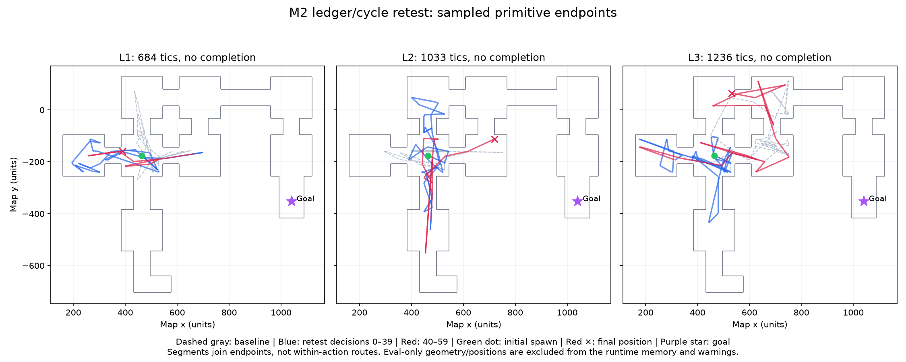

# M2 landmark/outcome ledger and visual-cycle retest

2026-11-04. Follow-up to the [baseline investigation](m2-results.md), on `feat/m2-grounder` / PR #10. The user authorized implementing the targeted memory/warning changes and repeating the same three 60-decision experiments. **The retest demonstrates more exploration in L2/L3, but no level completion.** One seed and one stochastic run per level cannot establish that the changes caused the differences.

## Implemented changes

- The existing 1,500-character model-written scratchpad now serves as the landmark/outcome ledger through the existing `note(text, mode)` tool. Versioned [system_v3.md](../prompts/system_v3.md) asks Muse to retain visual appearance, attempted action/decision, observed outcome, and uncertainty/next hypothesis; update after a new landmark, observed interaction result, or cycle warning; and compact with `replace`. No outcome is invented or assigned by the harness. The ledger is saved in `memory.json`; each update is logged with `source=model_note`.
- `locate` results, including failed/unverifiable lookups and unverified candidate confidence/bearing, now survive into later decisions in the rolling log. The existing two text stores remain: model-written scratchpad and 20-decision visible action/tool history. Each history row is bounded at 1,600 characters, retaining the newest evidence/action on overflow. No engine coordinates, labels, topology, or live map positions enter these stores.
- The visual-cycle detector sees only the current JPEG. It crops to the top 75% to exclude the HUD and most weapon motion, downsamples RGB to 32×24, and compares mean absolute pixel difference on [0,1]. It warns at MAE ≤0.04 against two earlier views, each at least six decisions old, with matches at least three decisions apart. It retains 48 descriptors and warns at most once per four decisions. Thresholds were frozen before the live retest. These are appearance matches, not odometry or proof of a revisit; the warning explicitly acknowledges lookalike places.
- Warnings only add text to the current prompt. They never select, clamp, reorder, or execute game actions. The existing identical-action warning remains. All runtime inference remains Muse Spark / SAM on Meta; the image comparison is deterministic pixel processing, not another AI model.

An offline replay through the *baseline* JPEG sequences would have emitted 1 / 6 / 2 visual warnings in L1/L2/L3, where the original identical-action guard emitted none. This is a detector check, not a counterfactual gameplay result or an estimate of warning precision.

## Fixed experiment protocol and results

All three fresh runs use committed runtime checkpoint `9e7625e`, `my_way_home`, levels 1/2/3, seed 101, Muse Spark 1.3 / low effort, hybrid grounding, **60 decisions**, 2,100 tics, 900 wall-clock seconds and **USD 0.60 stop threshold per episode**. Config dictionaries, initial spawn, L2 briefing hashes and the frozen L3 map match the baseline; prompt/runtime hashes differ because of the authorized changes. No prompt or detector tuning occurred during the runs.

| Level | Outcome | Acts / decision limit | Tics used | Ledger updates | Visual warnings | Cost USD |
|---|---|---:|---:|---:|---:|---:|
| L1 | `max_decisions`, no win | 59 / 60 | 684 | 27 | 2 | 0.34680015 |
| L2 | `max_decisions`, no win | 60 / 60 | 1,033 | 21 | 5 | 0.36663055 |
| L3 | `max_decisions`, no win | 60 / 60 | 1,236 | 24 | 3 | 0.31053015 |

**Total for the repeated 60-decision experiments: USD 1.02396085**, including grounding (USD 0.025422 total). Baseline episodes cost USD 0.84690350; this retest costs 20.9% more. Costs use returned usage/configured rates, not an account invoice; an in-flight response may cross a stop threshold before its usage is known. None of these runs approached the cap.

L1 decision 2 consumed its four tool-call rounds on a note, two rejected actions, and a lookup, with no action executed. It still counted toward the same 60-decision cap. The harness did not supply a fallback or extend the run to compensate.

## Measured changes in behavior

Entries below are **baseline → retest**, using the same offline trajectory definitions as the baseline report. Grid counts reflect sampled endpoints, not continuous walkable coverage; straight-line goal distance ignores walls and is not path progress.

| Measure | L1 | L2 | L3 |
|---|---:|---:|---:|
| Unique 128-unit cells | 6 → 6 | 4 → 9 | 9 → 14 |
| Unique 64-unit cells | 13 → 12 | 9 → 18 | 24 → 29 |
| New 128-unit cells in final 20 decisions | 1 → 0 | 0 → 2 | 0 → 5 |
| New 64-unit cells in final 20 decisions | 2 → 1 | 0 → 3 | 1 → 14 |
| Known-cell reentries / all cell entries | 12/18 → 16/22 | 18/22 → 18/27 | 23/32 → 30/44 |
| Near-repeated poses (≤24 units, ≤15°, ≥6 decisions apart) | 12 → 5 | 26 → 7 | 3 → 8 |
| `use` attempts | 12 → 8 | 15 → 2 | 6 → 3 |
| Translation collision proxy / translations | 4/29 → 0/34 | 4/30 → 5/50 | 3/45 → 1/49 |
| Best Euclidean goal distance | 433.3 → 389.2 | 344.2 → 400.1 | 339.0 → 334.3 |
| Final Euclidean goal distance | 497.9 → 678.2 | 548.4 → 400.1 | 468.2 → 656.9 |



The [replay samples](m2-ledger-replay-samples.jpg) come from actual native MP4s. Manually inspected 12 endpoint frames per level, at decisions 0,5,…,50,59, alongside the telemetry/action traces. L1 still shuttles between similar corridor ends and plateaus late. L2 explores the northern area and red-pillar branch and reduces repeated panel interactions. L3 also reaches the red branch and northern rooms late, rather than staying in its earlier small loop. These are new local explorations, not verified movement along a correct route: **the goal is never visible in any of the three retests**. L3's near-repeated poses and absolute reentries increase, and its final goal distance worsens. The changes do not resolve navigation globally.

The warning and ledger are active, not merely configured: all 72 saved ledger updates were reconstructed byte-for-byte from actual model `note` calls, and all ten visual warnings carry their matching decision IDs and measured pixel errors. Each warning was followed by a model note in the same or next decision. For example, an L2 model note at decision 57 says it is cycling through similar walls/bars/lockers and proposes a different exploration hypothesis. That is model-written speculation, not a harness navigation command or verified diagnosis.

## Verification and limitations

- **79 tests passed**, four M0 live tests deselected, **7.05 seconds**; lint and formatting pass. Tests cover alternating-view cycles, cooldown, HUD exclusion, novel-view reset, bounded detector history, persistence of uncertain grounding evidence, ledger bounds, same-response note/action handling, unchanged model actions, and all three information levels including rejection of telemetry injected into notes.
- All **256 executed primitives** (73 / 93 / 90) match model act calls. The ledger is exactly the result of model notes; no independent semantic content is synthesized. All three start at `(464,-176,0)`, yaw `338.93920906329043°`, raw tic 10, identical to the baseline. L1/L2 render no map; L3 renders once and its map hash is unchanged.
- Three native MP4s (1280×720 H.264, 35 fps) match final telemetry tics **694 / 1043 / 1246** and rewards within 1e-8. Runtime source and artifact hashes are verified in [m2-ledger-evidence.json](m2-ledger-evidence.json). Model-written ledger snapshots and individual visual-warning evidence are included there; recordings and raw run logs stay local in ignored `runs/`.
- No API or grounding errors occurred. Invalid action responses were rejected 3 / 3 / 5 times: missing `intent` or a non-boolean `run`, without clamping or partial execution. No note exceeded its schema limit. These invalid calls and the L1 non-action decision remain part of the results.
- Caching is mixed: after the first response, cached input tokens are nonzero on **77/85**, **69/81**, **83/84** Pilot responses. Unlike the baseline, not every subsequent response has a cache hit. These are actual provider usage fields; no cache hit is assumed merely because the prefix is stable.
- Visual similarity can conflate different places or miss changed viewpoints of the same place. Warning precision is not established. Model notes can misidentify landmarks, contain unsupported hypotheses, or forget entries when compacted. The test measures the combined memory/prompt/warning change; it does not isolate each component's effect.
- Independent SAM text localization, reliable door/switch identity, and the Freedoom exit marker remain unresolved as documented in the baseline. No M3–M5 features or specification changes are included.

## One longer episode

The measured late exploration in L3 triggered the user's earlier conditional authorization for one higher-decision test. It was a separate fresh L3, seed-101 run using the exact frozen implementation, **120 decisions maximum, the same 2,100-tic limit, USD 0.60 stop threshold, and 900 wall-clock seconds**. No replayed route, telemetry, checkpoint memory, or ground-truth target information was supplied to the agent. Muse responses are stochastic; this fresh run did not reproduce the 60-decision retest trajectory.

It terminated as **`budget_exhausted` at decision 112, after 111 model act calls and 2,017 tics**, at **USD 0.60291260**. The final response crossed the threshold by USD 0.00291260 before usage was known; its returned action was not executed. Wall time was 567.64 seconds, and the native tic limit had not yet expired. It did not complete the level and never saw goal pixels.

Within this longer run's own trace, its first 60 decisions visited eight 128-unit cells (initial cell plus seven new) at USD 0.31339685. The subsequent 51 executed decisions added only **two** new 128-unit cells and seven 64-unit cells, while travelling a further sampled 5,300.3 map units. Both new coarse cells appeared at decisions 60 and 62; decisions 63–110 added none. Overall, **50/60 cell entries** were reentries. Best/final straight-line goal distance was 347.3 / 474.2 units. This extension mostly prolonged local traversal rather than establishing a route to completion.

The longer run wrote 35 ledger updates and received 12 visual warnings. All 169 executed primitives match model acts, with no API or grounding error; four invalid action responses were rejected. Its H.264 replay matches final tic 2027 and reward −0.2017 within 1e-8. Measurements, provenance and the final ledger are in [m2-ledger-extended-evidence.json](m2-ledger-extended-evidence.json).

**Total for this follow-up: USD 1.62687345** (three fixed 60-decision runs plus the one capped longer run). Including the original M2 probes and baseline experiments, cumulative recorded M2 cost is USD 2.73394330. No further runs or budget increases were performed. The evidence supports more exploration in the fixed retest, with persistent semantic/navigation limitations; it does not verify reliable completion or establish a defect in the level.

Reproduce a standard retest (repeat with levels 1, 2, 3):

```bash
UV_CACHE_DIR=/tmp/autoqa-uv-cache make test
UV_CACHE_DIR=/tmp/autoqa-uv-cache make lint
uv run --locked autoqa run --scenario my_way_home --level 1 --seed 101 \
  --max-decisions 60 --max-usd 0.60 --grounding-mode muse_box_sam
uv run --locked autoqa replay <run-directory>
uv run --locked python scripts/inspect_m2_trajectories.py <L1-run> <L2-run> <L3-run> \
  --out <trajectory-audit.json>
```
