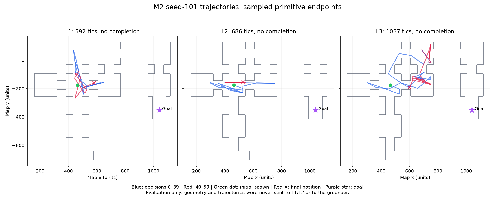

# M2 grounding and information-level results

2026-11-04. Work on `feat/m2-grounder`, based on synchronized `main` at `12d8432` after PR #9. References [M2 #4](https://github.com/Ramsi-K/vizdoom-agent-research/issues/4) and [parent #1](https://github.com/Ramsi-K/vizdoom-agent-research/issues/1). **Partial milestone: implementation and engineering checks pass; reliable semantic grounding and level completion have not been established.**

The existing uncommitted `docs/02-agent.md` edit was backed up and preserved byte for byte. No project specification or README changes are included. M3–M5 are not implemented.

## Implementation

- Added Meta-only `sam-3.1` streaming grounding with the official `meta_sam_parser`, full-raster mask projection, confidence filtering, pixel boxes, optical bearings, vertical bands, area fractions, mask/overlay artifacts, and sanitized raw-event audits. Empty output and parse/API failures are distinct results.
- Added an explicit experimental `muse_box_sam` mode: Muse Spark proposes normalized boxes from the current JPEG, then SAM segments those boxes. Direct `sam_text` remains selectable. Modes never switch automatically. Every candidate has `identity_verified=false`; conditional SAM confidence is not semantic validation. Failed grounding never selects a gameplay action.
- Added the `locate` tool to the real Pilot loop. It sees only the current 640×480 JPEG and concept. Grounding requests count toward the episode's USD and wall-clock budgets. Read-only tools run before an `act` returned in the same batch, preserving correspondence with the observed frame.
- Enforced L1/L2/L3 information boundaries in prompt construction and the outbound media gate. L1 retains its exact task with no briefing/map; L2 adds the four-section scenario briefing; L3 adds the same briefing and a frozen initial map. The gate admits only the exact current JPEG, bounded prior thumbnails, and (L3 only) initial PNG, rejecting arbitrary image substitutions and telemetry fields.
- Added briefings for all four ordinary scenarios and a static sector-based map with walls, thresholds, scale, north, spawn heading, known armor goal, and topology-derived terminal-branch tags. The renderer never tracks the player's current position. No route coordinates or room sequence are added to briefings.

## Grounding investigation and choice

The request schema and parser were checked against Meta's official [image understanding](https://dev.meta.ai/docs/image-understanding), [SAM segmentation](https://dev.meta.ai/docs/sam/segmenting), and [SAM client libraries](https://dev.meta.ai/docs/sam/client-libraries) documentation. Muse boxes use normalized 0–1000 coordinates and are validated before conversion to pixels. SAM box prompts use the official prompt builder, data-URL JPEG inputs, streaming Responses, `one_bit` encoding, and requested confidence. The installed parser exposes `parse_responses_stream(..., image_segmentation_format()).final_result()`; it does not expose `parse_image_stream`.

A preliminary three-frame control found genuinely empty text-SAM output on armor, medkit, and an absent target. Muse-box/SAM decoded nonempty masks on the positive controls: armor IoU **0.7043**, medkit IoU **0.9767**; the absent control produced no box. Those exploratory controls cost **USD 0.022133** and were not used as the final accuracy estimate.

Next, fixed calibration traces captured seven positive frames each from `my_way_home`, `health_gathering_supreme`, and `freedoom2_map01`, before model evaluation. Evaluation paired both methods on **21 positive and seven negative cases**. Runtime requests received pixels and a short concept only; actor labels/positions/masks were used solely for evaluation. A hit requires a predicted mask to overlap a matching visible actor mask at **IoU ≥ 0.5**. A nonempty mask alone is not a hit.

| Method | Positive hits | Negative false positives | Incomplete cases | Recorded cost, USD |
|---|---:|---:|---:|---:|
| Text SAM | 0/21 | 0/7 | 0 | 0.07000000 |
| Muse box → SAM | 10/21 | 2/7 | 0 | 0.16803335 |

| Scenario | Hybrid mask hits | Hybrid false positives | Muse box IoU ≥ 0.5 | Mean best Muse box IoU |
|---|---:|---:|---:|---:|
| `my_way_home` | 5/7 | 1/3 | 6/7 | 0.6817 |
| `health_gathering_supreme` | 5/7 | 1/2 | 5/7 | 0.7023 |
| `freedoom2_map01` | 0/7 | 0/2 | 0/7 | 0.0000 |

All **28 text-SAM streams** completed with zero output text in both the raw stream and parsed result. Their empty results were not caused by a parser discarding model output. The hybrid's **29 SAM streams** contained nonempty wire text; all raw/parsed text comparisons matched. A recorded nonempty stream is committed as a test fixture and exercises box, confidence, one-bit decoding, full-image projection, vertical band, and foreground area (1,475 pixels).

The experimental hybrid default was selected only after this comparison (see [grounding-validation.json](../configs/grounding-validation.json)). It offers partial signal but is **not reliable independent localization**: 47.6% mask hit rate and 28.6% false-positive rate on this small, non-independent sample, with complete failure on the sampled Freedoom targets. Muse localization accuracy was measured separately rather than inferred from SAM's confidence. Door/switch identity accuracy remains unverified.

## Bearing and boundary checks

The required ten real recorded frames (five each from `my_way_home` and Freedoom) have optical-box bearing MAE **0.05362°**, maximum **0.08671°**, against actual actor/camera coordinates. Across all 42 captured visible-actor records, per-scenario MAE is 0.06584° / 0.04176° / 0.04680°. These validate the projection math using ground-truth boxes; they do not establish localization accuracy.

For hybrid masks that actually match a target at IoU ≥ 0.5, conditional bearing MAE was **0.19815°**. No bearing accuracy is claimed for misses or false positives.

`make test`: **70 passed, four live-API tests deselected, 6.74 s**. Lint and format checks passed. Tests cover the ten bearing fixtures; actual SAM wire decoding and mask geometry; invalid box rejection; strict five-tool schemas; L1/L2/L3 prompt and exact-image boundaries; native paired spawn; frozen map persistence; model-only action execution; and grounding budget exhaustion before a parallel action. Live evidence below comes from explicit real experiments, not the deselected M0 live tests.

## Real seed-101 episodes

All three used committed runtime `16afed7`, Muse Spark 1.3 / low effort, experimental hybrid grounding, 60 decisions, 2,100-tic limit, USD 0.60 stop threshold, and 900 wall-clock seconds. Runtime source hashes are included in the evidence and were checked against the final runtime files. Subsequent changes add tests and reporting only.

| Level | Outcome | Tics used | Pilot calls | `locate` calls / candidate-positive | Grounding model requests | Total USD (grounding included) | Grounding USD |
|---|---|---:|---:|---:|---:|---:|---:|
| L1 | `max_decisions` | 592 | 71 | 8 / 4 | 16 | 0.29571165 | 0.04875025 |
| L2 | `max_decisions` | 686 | 80 | 19 / 2 | 21 | 0.31740220 | 0.05705850 |
| L3 | `max_decisions` | 1,037 | 68 | 8 / 0 | 8 | 0.23378965 | 0.01483775 |

**None completed the level.** “Candidate-positive” is only a returned mask, not a verified target. All three began at `(464, -176, 0)`, heading `338.93920906329043°`, raw tic 10. Every Pilot response after the first reported nonzero cached input tokens. L1/L2 rendered zero maps; L3 rendered exactly one initial map, hash `aa34daddff1409d7ccabae7c6000e0ca8e8266075b8ec65543c34c47e77f7685`.

The action audit matched every executed primitive to a model `act`: L1 **71/71**, L2 **66/66**, L3 **87/87**, with zero unmatched actions. Invalid tool responses were rejected (2 / 2 / 0). Grounding errors were 0 / 0 / 0. L2 had one Pilot `APITimeoutError`, recovered by the existing bounded retry; L1/L3 had no API errors.

All three native `.lmp` recordings were replayed to readable 1280×720 H.264 MP4 at 35 fps. Final tics 602 / 696 / 1047 and rewards match terminal telemetry (reward tolerance 1e-8). Raw recordings, MP4s, masks, and sanitized stream traces remain under ignored `runs/`; sanitized measurements and hashes are committed in [m2-evidence.json](m2-evidence.json).

## Why the 60-decision runs failed

Inspected all primitive/decision telemetry and action intents, the initial geometry, and 12 actual MP4 frames per run at decisions 0, 5, …, 50, 59. This was sampled visual inspection, not a claim to have manually watched every frame. See the [trajectory diagram](m2-trajectories.png), [replay samples](m2-replay-samples.jpg), and full [trajectory evidence with definitions and decision traces](m2-trajectory-evidence.json).



| Measure | L1 | L2 | L3 |
|---|---:|---:|---:|
| Sampled path length, map units | 2,308.6 | 2,779.5 | 3,638.6 |
| Net displacement from spawn, map units | 117.7 | 66.8 | 137.0 |
| Known-cell reentries / all cell entries (128-unit grid) | 12/18 | 18/22 | 23/32 |
| New 128-unit cells in final 20 decisions | 1 | 0 | 0 |
| New 64-unit cells in final 20 decisions | 2 | 0 | 1 |
| Near-repeated poses (≤24 units, ≤15°, ≥6 decisions apart) | 12 | 26 | 3 |
| Half-turns (180°) | 7 | 14 | 9 |
| `use` calls / observed sector-height activations | 12 / 0 | 15 / 0 | 6 / 0 |
| Translation collision proxy / translation primitives | 4/29 | 4/30 | 3/45 |
| Start / best / final Euclidean goal distance | 602.3 / 433.3 / 497.9 | 602.3 / 344.2 / 548.4 | 602.3 / 339.0 / 468.2 |

These are endpoint-based diagnostics, not navigation success or continuous coverage measures. Straight lines between sampled endpoints can cross walls; they are not reconstructed within-primitive routes. Euclidean distance ignores walls; coarse BFS remains unresolved. The existing collision flag is an acceleration-sensitive displacement proxy, not a ground-truth collision detector.

- **L1:** cycles among the starting corridor, blue-bar texture, and locker-lined side room. It does make small new local excursions late, but its best goal distance was already reached at decision 12, and the goal was never visible. It repeatedly uses decorative-looking locker panels. Its single note preserves the hypothesis that lockers may hide a secret; no interaction in the recorded run changed sector heights.
- **L2:** the clearest loop. Late actions shuttle along the same corridor between gray panels and a tech-textured wall, repeatedly turn 180°, and retry `use`. Decisions 50–59 repeatedly return to these same ends; final-20 novelty is zero even at 64-unit resolution. This is substantial movement without new traversal progress.
- **L3:** initially explores more of the northern room and pillar cluster. By the final 20 decisions it is cycling through already visited space, alternating forward/backward moves and turns near wall/torch surfaces. **14/17** final-window translation endpoints are within 17 units of a static blocking line, consistent with close wall contact/sliding for a radius-16 player. Only one new 64-unit endpoint cell appears, and no new 128-unit cell. Its best goal distance at decision 51 improves the early best by only 19.5 units before it returns to 468.2 units away; the goal is never visible. This is limited local exploration followed by a plateau, not evidence of sustained movement along a route to the goal.

The controls are working: maximum turn error across the three recordings is **0.00367°**. Almost all translation primitives produce measurable movement (only one endpoint displacement below one unit across 104 translations). The dominant failure is repeated local navigation and uncertain visual interpretation, with wall contact/sliding in L3, rather than a frozen engine or pervasive zero-motion collisions. None of the runs ever shows goal pixels in eval labels.

**Likely cause, not proven causal attribution:** visually similar surfaces are treated as new doors/openings without a durable landmark/outcome record. L2/L3 wrote no notes; L1 wrote one speculative note. The bounded action history retains commands and screen-change percentages, but not a persistent record of failed landmark interactions or older visual states. `locate` cannot reliably resolve those ambiguities: semantic door/switch localization is unvalidated. The existing stuck guard requires three *identical* actions with <2% screen change; alternating turns and backtracking change the image and evade it. It emitted **zero warnings** in all three runs.

**Decision:** no additional higher-budget episode was run. The final-window traces support local looping/plateau, not a budget-only failure. Recommended targeted M2 follow-up: have Muse maintain a compact, model-written landmark ledger (appearance, attempted action, visible outcome, next hypothesis), persist `locate` uncertainty with that landmark, and use a visual-only repeated-view/action-cycle warning that asks the model to reconsider. Preserve the static L3 map and forbid coordinates/telemetry in that feedback. These would be model context and text-warning improvements; they must never choose a turn or route. Validate them with the same seed and 60-decision/USD cap before attempting a longer completion run. This recommendation has **not** been implemented or shown to improve completion.

## Costs and incomplete requirements

Recorded costs: preliminary probes **USD 0.022133**, paired grounding **USD 0.23803335**, three episodes **USD 0.84690350**, total **USD 1.10706985**. These use completed response usage and configured Meta pricing, including [SAM's per-image price](https://dev.meta.ai/docs/pricing-rate-limits); they are not an account invoice. The timed-out request supplied no usage, so any provider-side charge for that attempt cannot be verified. An in-flight response may cross a USD threshold before usage is returned; subsequent actions are stopped.

Incomplete or intentionally unverified:

1. Independent text-guided SAM localization still fails; the hybrid is partial, has false positives, and failed all sampled Freedoom positives. No door/switch semantic IoU or reliable long-range localization is claimed.
2. All three real runs terminate normally at their decision cap, but none wins. The gameplay-completion criterion is not marked passed.
3. The Freedoom map renders real walls/spawn/scale but has no validated exit marker. It explicitly says the goal position is unannotated; the specification's Freedoom green-goal-pixel expectation is **not met**. Tests record this limitation instead of inventing an exit position.
4. Native `my_way_home` starts at raw tic **10**, not the specification's literal tic 1. The map is frozen once at that actual initial state. Forcing tic 1 was already found to suppress early controls in M1; the spec is unchanged.
5. Grounding requests currently make one attempt; failures are explicit `could_not_verify` results. Pilot request retry behavior remains bounded as in M1. Account balance/credits are not verified.

Reproduction (live commands incur Meta API costs):

```bash
UV_CACHE_DIR=/tmp/autoqa-uv-cache make test
UV_CACHE_DIR=/tmp/autoqa-uv-cache make lint
uv run --locked python scripts/capture_m2_fixtures.py --out runs/m2-fixtures
uv run --locked python scripts/run_m2_grounding_experiment.py
# Repeat independently with --level 1, 2, 3:
uv run --locked autoqa run --scenario my_way_home --level 1 --seed 101 \
  --max-decisions 60 --max-usd 0.60 --grounding-mode muse_box_sam
uv run --locked autoqa replay <run-directory>
# Offline diagnostic of the three recorded 60-decision runs:
uv run --locked python scripts/inspect_m2_trajectories.py <L1-run> <L2-run> <L3-run> \
  --out runs/m2-investigation/trajectory-audit.json
```

Experiment output directories must be fresh; completed experiments are retained rather than overwritten. Native engine checks require execution outside this environment's restrictive coding sandbox. `.env`, API keys, raw run directories, request headers, and opaque reasoning are not committed.
