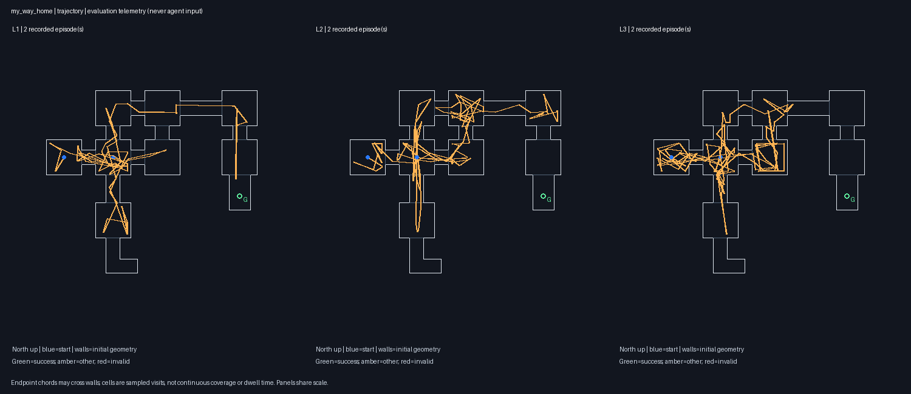
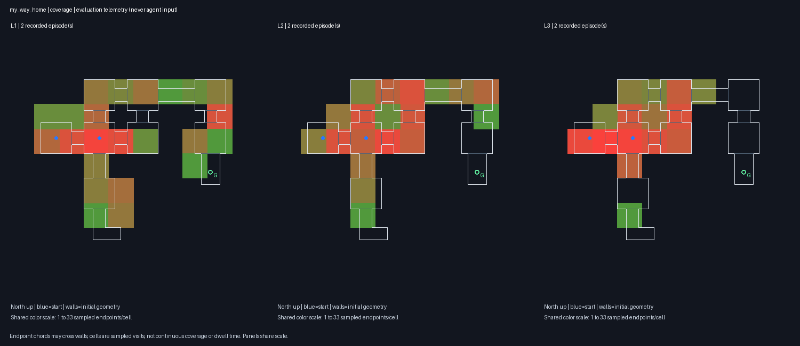

# M3 — Sweep and metrics implementation

4 November 2026. Implemented on `feat/m3-sweeps` from merged documentation/M2 commit `0fe5214`. **Offline implementation is validated. The approved fast sweep was subsequently stopped early at the user's request; six completed `my_way_home` runs are analyzed below.** Full multi-scenario live acceptance remains incomplete. M4–M5 remain out of scope.

See [partial fast-sweep results](#partial-fast-sweep-stopped-early) and [compact live evidence](m3-fast-partial-evidence.json). The offline validation and preparation sections retain their earlier checkpoint findings.

## Implemented

- `autoqa/eval/metrics.py`: episode metrics from existing manifests, telemetry, events, geometry, and optional verified native-replay metadata. Source log hashes are checked when recorded. Original artifacts are not rewritten by offline analysis.
- `autoqa/eval/aggregate.py`: per-scenario/level summaries, invalid-run exclusions, all-recorded cost totals, matched-seed L2−L1 and L3−L2 deltas, Wilson completion intervals, and deterministic percentile-bootstrap intervals for means/deltas with at least two observations. Each metric retains its own sample count; unavailable values are `null`/blank, not zero.
- `autoqa/eval/plots.py`: same-scale L1/L2/L3 trajectory and sampled-cell heatmaps over initial geometry, with shared heat intensity, initial spawn markers, known armor goals, and outcome colors. Fault probes are excluded. These are evaluation artifacts, never agent inputs.
- `autoqa/sweep.py`: strictly validated YAML, frozen source/prompt/calibration hashes, sequential execution through the existing `run_episode`, per-slot checkpoints, execution locking, resume without repeating recorded episodes, and per-episode/total recorded-usage thresholds. Source drift, changed configurations, and mismatched paired spawn/protocol evidence block further execution. An interrupted in-flight slot requires manual reconciliation because it may already have incurred charges.
- `configs/sweep_fast.yaml`: seeds 101–103; `my_way_home` L1/L2/L3 and `freedoom2_map01` L1/L2, **15 episodes**. Freedoom uses 60 decisions/4,200 tics.
- `configs/sweep_core.yaml`: seeds 101–105; `my_way_home`, `health_gathering_supreme`, and `freedoom2_map01`, all L1/L2/L3, **45 episodes**. Freedoom uses 100 decisions/4,200 tics; the other scenarios use 60/2,100.

The CLI adds `sweep`, `metrics`, and `analyze`. Sweep preparation is the default and does not load credentials or call models. Only `--execute` authorizes paid execution. Existing Pilot prompts, tools, memory, grounding, gameplay controls, and replay behavior are unchanged. No new dependencies, scripted navigation, Reviewer, verifier, carry-over, or offline AI embedder were added.

## Metric and classification rules

Progress uses consistently measured coarse-grid BFS distances; Euclidean fallback is not silently treated as navigable distance. A recorded success has progress 1, but SPL still requires a valid positive initial BFS distance. Health-survival runs without a spatial goal therefore cannot produce spatial progress/SPL on failed attempts.

Coverage is unique sampled cells divided by the spawn-connected 128-unit cell-center graph size, only when that graph resolves every sampled cell. It is an approximation of the coarse graph, not continuous walkable-area coverage. Path length sums primitive endpoint chords. Revisit rate is `1 - unique entered cells / cell entries`, including the initial cell and removing consecutive duplicates. Collision and `use` precision retain the existing displacement and sector-height-change proxies. `locate_hit_rate` measures candidate-positive tool returns, including delivered same-frame reuses; it does not measure semantic identity or target IoU. No-call denominators remain unavailable.

Pairs require matching model/settings, runtime source and asset/calibration hashes, guided briefings where applicable, and initial position/heading/tic. Within a scenario/level, mixed prompt/runtime/settings versions are rejected rather than pooled. Invalid API/runtime outcomes, interrupted/incomplete runs, and fault probes are excluded from gameplay means; their recorded spending remains visible. Failed-attempt charges can still be unknown.

The five documented classification rules are implemented with deterministic precedence: self-evident, negative map transfer, discoverability-sensitive, navigation-sensitive, and persistent failure. Labels are diagnostic hypotheses about the bundled information/navigation protocols, not causal effects or game defects. Per-seed labels are reported; a scenario receives a label only when all scheduled seeds provide matching classified triples.

The specification's rules are not exhaustive. Missing L3, missing progress needed by a rule, mixed seed labels, or an uncovered outcome pattern produces a `null` classification with an explicit status. In particular, fast intentionally omits Freedoom L3, so it cannot support a full three-level Freedoom classification. No extra classification or inferred result is fabricated to fill that gap.

## Offline validation

`make test`: **120 passed, four live-API tests deselected, 8.39 seconds**. `make lint`: lint and formatting passed (56 Python files). Native tests ran outside the restricted coding sandbox, as required by the existing ViZDoom tests.

The 28 new tests cover metric arithmetic, empty/missing data, hash/non-finite rejection, candidate reuse, native clock reconstruction and replay bounds, all five classification rules and unavailable cases, matched-seed deltas, invalid/probe exclusion, mixed protocols, readable heatmaps, configuration validation, no-call preparation, explicit execution gating, checkpoints, unknown spending, source drift, locking, and stopping on a bad pair. Injected sweep runners use explicitly synthetic fixtures; these are not gameplay results.

A separate local engine-only health-scenario diagnostic used test-only invulnerability to isolate timeout timing: startup tic 1, final tic 101 for a 100-tic limit and 2,101 for a 2,100-tic limit, alive at termination. This supports the existing elapsed-time outcome check; it is not an autonomous survival result, and no runtime control was changed.

## Reanalysis of existing M2 recordings

The new engine analyzed the existing latest L2/L3 seed-101 episodes, without rerunning gameplay. See [their original experiment report](m2-navigation-review.md) and [compact M3 evidence](m3-evidence.json). Original manifests/logs/native recordings remain unchanged.

| Measurement | Existing L2 | Existing L3 |
|---|---:|---:|
| Outcome | Decision limit | Success |
| Played tics | 732 | 1,280, from native replay reconstruction |
| Unique sampled 128-unit cells | 6 | 18 |
| Cell reentries / entries | 16/22 | 15/33 |
| Revisit rate | 0.72727 | 0.45455 |
| Collision proxy rate | 0.12500 | 0.06250 |
| Candidate-positive `locate` rate | 2/5 | Not applicable: zero calls |
| Recorded USD | 0.58523915 | 0.29667895 |
| BFS progress / SPL | Unavailable / unavailable | 1 (success) / unavailable |
| Coarse-component coverage | 6/16 = 0.375 | Unavailable: visited cells escape resolved component |

The matched L3−L2 revisit delta is **−0.27272727** and recorded cost delta is **−USD 0.28856020**, both from one pair. No bootstrap interval is supplied for a one-pair delta. L2/L3 navigation-update counts reproduce 51/37 and plan-linked action counts 59/42; these remain model declarations, not automatic planning verification. Both episodes contain a recovered API error, whose possible provider charge is unknown.

There is no matching L1 in this selected protocol set, so the reanalysis reports no three-level classification. Its JSON, CSV, per-episode metrics, and two inspected PNGs are local under `results/m3-existing-navigation-final/`. These are derived M2 observations, not a new M3 sweep or a completion-rate estimate. Normalized coverage is not comparable for this pair, and no progress/SPL delta is reported.

## Prepared live experiments — approval required

At the initial preparation checkpoint, both plans had every slot pending and status `prepared_no_api_calls`. Fast was later approved and stopped early; core remains unrun. The stopped fast plan must not be resumed without new instructions. The commands below document the original preparation/execution interface, not an instruction to continue the stopped sweep.

| Plan | Episodes | Per-episode USD threshold | Total recorded-usage threshold | Local plan directory |
|---|---:|---:|---:|---|
| Fast | 15 | 0.60 | 9.00 | `results/m3-fast-preflight/` |
| Core | 45 | 0.60 | 27.00 | `results/m3-core-preflight/` |

These thresholds are not provider-side hard caps: an in-flight response can exceed its limit before usage arrives, and failed-request charges may be unknown. The runner reserves one episode threshold before starting the next episode. Model defaults are Muse Spark 1.3, low effort, experimental `muse_box_sam`, 3,000 output tokens, and 900 wall-clock seconds per episode. The sums of episode wall limits are 3 h 45 min / 11 h 15 min before overhead; these are bounds from configuration, not duration forecasts. Fast completion within the specification's 60-minute target is unverified.

Preparation only, using a new output directory:

```bash
uv run --locked autoqa sweep --config configs/sweep_fast.yaml --out results/my-fast-plan
uv run --locked autoqa sweep --config configs/sweep_core.yaml --out results/my-core-plan
```

**Only after approval**, execute one chosen prepared plan (not both by default):

```bash
uv run --locked autoqa sweep --config configs/sweep_fast.yaml \
  --out results/m3-fast-preflight --resume --execute
# Alternative, only if core is approved instead:
uv run --locked autoqa sweep --config configs/sweep_core.yaml \
  --out results/m3-core-preflight --resume --execute
```

Source edits after preparation require a fresh plan. Credential/API access and credit balance have not been checked in this milestone. Recorded slots are not rerun on resume; an in-flight/locked slot needs manual inspection before proceeding. `sweep_manifest.json` records slot states/costs and analysis location. The latest `summary.json`/`summary.csv` are at the sweep root; numbered analysis directories retain earlier snapshots, metrics, and heatmaps. Each recorded episode also receives `metrics.json`.

Offline commands, with no API calls:

```bash
uv run --locked autoqa metrics runs/<run_id> --out results/new-episode-metrics.json
uv run --locked autoqa analyze runs/<L1-run> runs/<L2-run> runs/<L3-run> \
  --out results/new-offline-analysis
```

Offline output paths must be new. Duplicate scenario/seed/level records and mixed within-level protocols are rejected; separate historical protocol iterations into separate analyses.

## Acceptance status and remaining limits

1. **Live paired episodes on at least `my_way_home` and Freedoom:** incomplete. Two new paired `my_way_home` seeds were completed before the user stopped fast; Freedoom has not been run. Historical M2 reanalysis does not fill the missing multi-scenario evidence.
2. **Metric summaries and paired deltas:** implemented and validated offline, including real recorded M2 inputs. BFS/SPL/coverage and no-call ratios remain explicitly unavailable where evidence is insufficient.
3. **Information-sensitivity classifications:** all five rules tested; real scenario labels await complete compatible evidence. The missing-L3 fast condition and non-exhaustive rules prevent guaranteeing a label for every scenario without changing the research criteria.

Freedoom still has no validated exit annotation for distance-based progress. Static coarse-grid distances can fail in narrow/disconnected cells and are not proof of a real progression blocker. Human references and causal map/grounding ablations have not been run. No M4 verification/reporting or M5 features are implemented, and no project specification or README was rewritten for M3.

## Partial fast sweep — stopped early

The user approved the existing fast configuration and USD 9 threshold, then requested a stop after L3 seed 102. **Six complete runs are preserved: seeds 101 and 102, each at L1/L2/L3. All six reached the 60-decision limit without collecting the armor.** Their initial spawn/protocol checks passed, and recorded native-demo/event/telemetry hashes were verified. No API or grounding errors were logged in those six runs.

The requested boundary was missed: the runner started seed 103 L1 before the stop was applied. That extra run was interrupted after decision 8; shutdown then blocked and required SIGTERM. Its raw artifacts and unfinalized manifest are retained at `runs/20261104T173044.780340Z_my_way_home_L1_s103/`, but it is **excluded from gameplay comparisons**. The other eight planned episodes were never started. No Freedoom episode or core sweep ran. The original pre-stop sweep manifest is retained alongside the explicitly annotated stopped manifest and `stop-accounting.json`.

| Accounting | Recorded USD |
|---|---:|
| Six completed episodes | 2.80618700 |
| Interrupted extra episode, completed usage events | 0.05641210 |
| Total known recorded usage | **2.86259910** |

An in-flight request charge for the interrupted episode may be unknown; these numbers are returned-usage estimates, not an invoice. The six completed runs and the partial extra record were not deleted or rewritten to hide the missed stop.

### Available metrics

| Level | Completed levels | Mean sampled cells | Mean revisit rate | Mean collision proxy | Mean recorded USD |
|---|---:|---:|---:|---:|---:|
| L1 | 0/2 | 14.0 | 0.4898 | 0.0662 | 0.364579 |
| L2 | 0/2 | 12.0 | 0.6307 | 0.0589 | 0.563271 |
| L3 | 0/2 | 10.5 | 0.6996 | 0.0384 | 0.475243 |

Each group has only two observations. Its Wilson 95% completion interval is approximately [0, 0.6576], so the observed zero wins is not a precise reliability estimate. All six used 60 decisions; L1/L3 executed 60 acts per episode, while L2 executed 59. Played tics were L1 721/1,106; L2 975/1,073; L3 1,354/1,119, for seeds 101/102 respectively.

Matched-seed mean deltas:

| Comparison | Sampled cells | Revisit rate | Recorded USD |
|---|---:|---:|---:|
| L2 − L1 | −2.0 | +0.1409 | +0.198692 |
| L3 − L2 | −1.5 | +0.0689 | −0.088028 |

L2 produced four candidate-positive returns across nine `locate` calls; those identities remain unverified. L3 had one lookup, which returned no candidate, and L1 made none. The mean per-episode L2 candidate rate is 0.45; its pooled count is 4/9. Neither is semantic localization accuracy. All observed `use` precision proxies were zero.

Evaluation telemetry recorded goal visibility in L1 seed 101 and L2 seed 102, but neither collected it. Both L3 runs remained without visible goal pixels. The saved trajectories show repeated local traversal; L3 did not reach the goal branch. Lower collision proxies therefore did not translate into greater exploration or completion in this sample. The earlier M2 L3 victory was not reproduced in these two trials. This is descriptive evidence about two stochastic, bundled-protocol comparisons, not proof that briefing or map access caused worse behavior.

BFS progress, SPL, and normalized coverage are unavailable for these six runs. The heatmaps show **sampled-cell visit counts**, not normalized walkable-area coverage. No three-level information-sensitivity label is assigned: although all runs failed, the documented persistent-failure rule also requires measured L3 progress below 0.8. That progress is unavailable; seed 103 and Freedoom comparisons are additionally unrun.

### Preserved outputs

The PR includes the [CSV summary](m3-fast-partial/summary.csv), [six-run evidence](m3-fast-partial-evidence.json), and the two compact images below. Full native recordings, screenshots, and request/event traces remain local under ignored `runs/`; they are not bundled in the PR.





The complete local analysis outputs are:

- `results/m3-fast-preflight/summary.json` and `summary.csv`: partial results, planned-versus-recorded counts, paired deltas/intervals, unavailable fields, and separate interrupted-run cost accounting.
- `results/m3-fast-preflight/analysis_partial_000/`: immutable analysis snapshot with six per-episode metric files and `heatmaps/my_way_home_trajectory.png` / `my_way_home_coverage.png`. Both images were inspected. No Freedoom heatmap is fabricated.
- `results/m3-fast-preflight/sweep_manifest.json`: `stopped_early_by_user`, six recorded slots, one interrupted extra slot, and eight `not_run_user_stopped` slots.
- Original completed `.lmp`, frames, memory, events, telemetry, and manifests remain in their run directories; [m3-fast-partial-evidence.json](m3-fast-partial-evidence.json) records their IDs, source hashes, measurements, and output hashes.

Core remains `prepared_no_api_calls` with all 45 slots pending. Neither plan was resumed after the stop.

## Post-sweep investigation — M1/M2 reuse and effective navigation

This is a subsequent, read-only investigation of the six completed runs, prompted by concern that M3 had bypassed the localization and map-planning work. It is separate from the original experiment and results above. No gameplay was rerun, no paid request was made, and no measurement, outcome, or runtime implementation was changed. The local audit is saved at `results/m3-fast-preflight/m1-m2-reuse-audit.json`; the [six-run evidence](m3-fast-partial-evidence.json) identifies the original recordings and logs.

### Implementation and inputs were retained

Recorded source hashes were compared with merged M2 commit `209d861` for ten modules: `autoqa/run.py`; `autoqa/agent/{pilot,client,grounder,memory,guards,navigation}.py`; `autoqa/prompts/builder.py`; and `autoqa/doom/{env,plan_renderer}.py`. **All 60 module/run comparisons matched.** This verifies reuse of the M1 gameplay foundations and M2 grounding, memory, guards, navigation validation, prompt assembly, and map rendering in these runs.

For both seeds, the L2 and L3 prompt hashes match their respective earlier M2 navigation retests. Run settings match those retests when excluding the intentionally varied game seed: Muse Spark 1.3, low effort, experimental `muse_box_sam`, 60 decisions, 2,100 tics, USD 0.60 threshold, and the same request/output limits. The experimental grounder was not replaced with direct text-SAM or a stub.

The new L3 seed-101 run also matches the winning M2 run's initial spawn, first JPEG, and frozen map:

- Initial JPEG SHA-256: `2f5e07ae44f29a5089cab7e32daea4175b4959472f292ff362dda65f96553bf3`.
- Map SHA-256: `aa34daddff1409d7ccabae7c6000e0ca8e8266075b8ec65543c34c47e77f7685`.
- Each new L3 run recorded one static-map render. The unchanged prompt builder attaches the frozen map to the decision context. Seed 102 has its own initial-state map, as intended.

These checks establish implementation/input continuity, not repeatable model behavior. The game seed controls engine initialization; the client does not pass that seed to model inference.

### L2: grounding was active but seldom declared as the action basis

| Seed | `locate` calls | Muse box-proposal requests | SAM requests | Executed acts declaring grounding | Executed acts declaring visual navigation |
|---|---:|---:|---:|---:|---:|
| 101 | 4 | 4 | 3 | 2 | 57 |
| 102 | 5 | 5 | 6 | 3 | 56 |
| Total | 9 | 9 | 9 | 5 | 113 |

Thus the real Muse-box/SAM pipeline made 18 model requests, but only **5 of 118 executed L2 acts** declared grounding as their basis. These are model-written declarations, not five verified grounding-guided movements. Receipt validation establishes that cited evidence was available; it does not establish correct interpretation or effective steering.

Specific examples from the logs:

- Seed 101, decision 0: `gray door` returned an unverified candidate at approximately −22.263°. Muse cited `d0:gray door`, selected the candidate as its destination, and described approaching the door ahead-left. At decision 21 it cited the earlier `red pillar` result and explicitly described using its bearing to steer forward. These support some actual engagement with grounding results, without verifying identity or navigation benefit.
- Seed 102, decision 23: `green armor vest` returned no candidate, but the next NAV entry declared `basis=grounding` while pursuing a visually observed green speck. The note acknowledged the failed lookup. This is an example of a grounding-labeled act that does **not** establish candidate-guided movement, so the five declarations must not be interpreted as verified effective use.
- Other green-armor lookups returned no candidates, and most actions were labeled visual. A failed lookup is not proof that an object was absent. The four candidate-positive tool returns reported in the original results still have unverified identities.

The available capability was therefore present and exercised, while its influence on navigation was limited and partly ambiguous. The audit does not establish that increasing lookup frequency would improve performance; redundant calls and unreliable semantic candidates remain concerns.

### L3: map-specific intentions did not produce sustained route execution

| Seed | Accepted map-based NAV updates | Executed acts linked to map-based NAV | `locate` calls |
|---|---:|---:|---:|
| 101 | 57 | 60 | 1 |
| 102 | 52 | 60 | 0 |

Both runs wrote map-specific initial plans: identify the start region, leave toward the central junction, traverse the north/east connections, then move south toward the southeast goal room. This is evidence of map-referenced interpretation beyond merely receiving an image.

However, `basis=map` is required by the L3 validator. Consequently, the 120 map-labeled acts are protocol-compliance evidence, not proof that every action followed an effective route. The saved updates show persistent uncertain localization and local recovery:

- Seed 101, decision 30 still describes the central pillar/gray-panel area as uncertain and proposes backing off a block to find the east opening. Decision 40 calls the situation a wall-locked loop. Decision 59 describes a metal-corner dead end and returning to a hall junction, while retaining the same southeast goal destination.
- Seed 102, decision 30 still tentatively places the agent in the western start room and describes looping around pillars. By decision 50 it reports an uncertain central pillar maze; decision 59 says it is unclear whether cyclic views indicate the same place, and proposes another wall-following escape.

The trajectories and lack of visible goal pixels in either L3 episode agree with unsuccessful route execution. The logs support a likely weakness in maintaining/checking the current map region and subgoal progress: the agent repeatedly retained goal-direction language while reacting locally to walls. They do not isolate the cause or prove that the map was ignored, that localization alone caused failure, or that map access harmed performance. The earlier M2 winner also struggled with localization before eventually reaching the east/south goal branch; its one success did not establish reliability.

### Memory and warning behavior

The existing model-written ledger was active: accepted writes were 26/29 for L1, 49/55 for L2, and 57/52 for L3, for seeds 101/102 respectively. The visual-cycle guard emitted 3/2, 3/0, and 3/2 warnings for those same levels/seeds. These counts establish that the mechanisms ran; they do not establish successful learning or recovery.

Each episode deliberately began with a fresh scratchpad, recent history, and conversation under the documented no-cross-run-state protocol. The shared ledger means shared use by landmark/outcome notes and NAV within an episode. It does not mean memory is shared between episodes. The winning M2 run's notes and route were not loaded into M3. Cross-episode carry-over remains a separate, unimplemented M4 experiment.

### Implications for future work

The distinction is between **retained capability, recorded use, and demonstrated benefit**. Source/input checks verify retained capability. Tool calls, candidate citations, and map-specific notes demonstrate some use. Neither these declarations nor the six negative outcomes establish reliable grounding-guided movement, accurate map localization, or a causal benefit or harm.

Targeted future work should investigate evidence-backed landmark-to-region matching, explicit checks before advancing map subgoals, and recovery from contradicted or uncertain location hypotheses. Evaluation should distinguish a failed grounding receipt from a usable candidate and inspect whether the resulting movement matches the stated intention. These are proposed directions, not implemented fixes or demonstrated improvements. Any carry-over comparison should remain separate from fresh-memory trials; any further paid experiment requires new approval. This investigation does not justify simply increasing the decision or cost budget.
