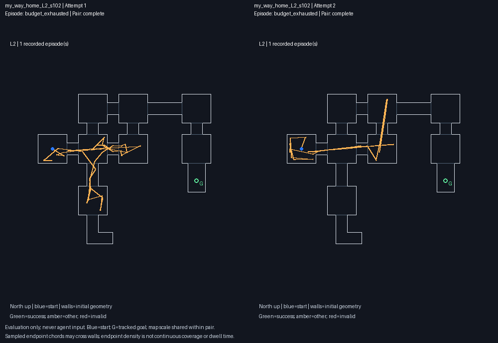
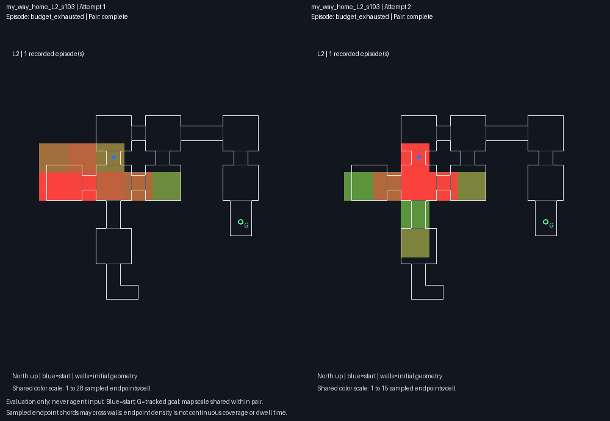
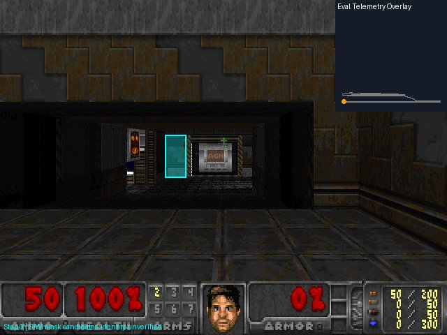

# M4 — Trace verification, QA reports and carry-over feedback

Validation: 2026-11-05 IST; artifact timestamps use UTC. Implements [issue #6](https://github.com/Ramsi-K/vizdoom-agent-research/issues/6) within its three-hour ceiling. M3 and M3.5 results, README prose and the project specifications are unchanged. The approved M4 live-validation threshold was **USD 4 of recorded usage**, with explicit reserves for unknown failed-request charges.

M4 adds a working reporting pipeline, not evidence that ordinary game levels are defective. The controlled fault was observed by the post-episode Reviewer and verified against the injected action log. The Pilot did not report it inline. Carry-over findings are reported separately from ordinary L1/L2/L3 comparisons.

## Implementation and information boundaries

- `autoqa verify` resolves cited saved frames and decision intervals, checks source hashes, applies behavioral rules and then conservative causal triage. Original `issues.json`, telemetry and manifests stay untouched; derived findings go to a separate output. Overlapping inline/Reviewer observations can merge; distinct Reviewer door claims remain separate.
- `autoqa report` creates self-contained `report.html`, `dossier.md`, verified captioned clips, trajectory/coverage plots, SAM candidate evidence, paired carry-over tables, human-reference context and usage/latency summaries. SAM rasters must match the original JPEG hash and retain the **identity unverified** qualification. Evaluation trajectory insets are labelled and never sent to the Pilot or Reviewer.
- `autoqa review` is preparation-only unless `--execute` is supplied. Muse Spark 1.3/high receives player-visible video or up to 24 original keyframes and an allowlisted decision log. Coordinates, object labels, geometry and verifier conclusions are excluded from model input. Structured output uses a strict `EpisodeQAReview` schema; incomplete JSON and unobserved evidence IDs are rejected. Usage is journaled before parsing. Unknown inference charges stop automatic Reviewer fallback.
- The opt-in `probe_broken_door` profile disables only requested `USE`, logs each modification and is excluded from ordinary gameplay metrics. `EnvironmentFaultInjector` rejects an enabled fault on an ordinary environment. Ordinary controls remain a direct pass-through.
- Ordinary aggregation rejects feedback-informed cohorts, and cross-level causal triage excludes them. A one-off `--carry-over` run is automatically tagged rather than pooled with cold benchmarks.
- Carry-over is an explicit two-attempt study. Only the prior agent's notes, self-reports, observable warnings/actions and outcome enter the capped brief. Attempt 2 starts fresh memory and receives the brief under `Observations from Your Previous Attempt on This Level`. Neither evaluator telemetry nor Reviewer advice enters the brief.

The live gameplay used local checkpoint `1b2c4901353c529a516a5e1646acc671496ee5c3`, frozen in a separate checkout. Its tree is identical to [published checkpoint `55c8b81`](https://github.com/Ramsi-K/vizdoom-agent-research/tree/55c8b813ed0f1a5fb3b945d193ae87223f21f1c6) (`29e1c2f5631507cddec7b884251244bb14f77796`). Commit metadata differs; the recorded manifests retain their original SHA. Later reporting work did not change the source, model, prompts or controls between paired gameplay attempts. Verification/cohort checkpoint `f75215f` has the same tree as [published `cedfecb`](https://github.com/Ramsi-K/vizdoom-agent-research/tree/cedfecb70724f3782a028127044e49ff043b01aa). Final code `6a17d1c` is tree-equivalent to [published `5c8428a`](https://github.com/Ramsi-K/vizdoom-agent-research/tree/5c8428a2fa0bbf8056173b6b85b20ff27289aae8).

## Live QA validation

The ordinary observations below are retrospective reviews of existing recordings, not new gameplay experiments. No existing experimental measurements were rewritten. The earlier M3 sweep's six completed runs and 15-slot plan remain explicitly marked **stopped early** in the new derived report.

| Reviewed case / input | Model findings | Confirmed | Contradicted | Unverifiable |
| --- | ---: | ---: | ---: | ---: |
| Ordinary my_way_home L2; default keyframes / 4k | 2 | 1 | 0 | 1 |
| Controlled fault; diagnostic keyframes / 8k | 3 | 1 | 0 | 2 |
| Ordinary Freedoom combat; widescreen-transcode video / 8k | 7 | 0 | 2 | 5 |
| Same Freedoom recording; native-640 video / 8k | 3 | 0 | 0 | 3 |

The two Freedoom rows review the **same** gameplay recording with different video inputs. They are separate diagnostic variants, not independent episodes or pooled detection results. The primary combined dossier uses the native-640 variant; the widescreen variant retains its own report and all seven original findings.

The ordinary `my_way_home` Reviewer described repeat visits and ineffective `use` attempts. The navigation symptom is supported by sampled cell reentries, while the interaction claim lacks a fully sampled 35-tic post-use interval. The navigation label is `CANDIDATE_NAVIGATION_FRICTION_OR_INTENTIONAL_MAZE`, not a defect verdict.

The ordinary Freedoom case uses the M3.5 **combat** profile (`freedoom2_combat_map01`), not the unrun `freedoom2_map01` navigation benchmark. A verifier contradiction concerns its stated sampled-window predicate; sector/reward changes do not identify the particular door, and displacement proxies do not resolve every short collision. No target-specific hallucination rate or genuine-defect detection rate is established.

### Controlled fault probe

Seed 101, L2, Muse Spark 1.3/low, hybrid grounding; limits: 40 decisions, 1,750 tics, USD 0.35 and 600 wall seconds. It ended `budget_exhausted` after 32 acts and 408 gameplay tics at **USD 0.35121615** returned usage. There were **11 requested `use` actions, all suppressed by the explicit fault**, ten sampled cells, zero translation collision flags and zero Pilot inline issues.

The blind keyframe Reviewer reported three observations. One early interaction observation has a complete sampled 35-tic post-use boundary, no sector/reward response, and an in-window `env_fault_blocked_use` event: `behavior_confirmed` / **`CONFIRMED_INJECTED_FAULT`**. Its other interaction and visual-ambiguity observations remain unverifiable. This establishes detection of the controlled no-effect symptom and the logged manipulation; it does **not** establish that every panel was a valid door, that alignment was correct, or that the level exit became unreachable. There was no matched unmodified navigation-control episode.

### Reviewer failures and protocol deviations

The default is the specified 4,000-token ceiling. One successful ordinary keyframe review used that setting. The fault review also produced an incomplete 4,000-token response: **3,781 reasoning tokens**, 4,000 total output tokens, and 826 public-text characters. It was charged and rejected, not salvaged as a successful review.

An 8,000-token diagnostic retry returned a valid fault review using **3,817 output tokens**, so the larger ceiling cannot itself be credited with causing success. The first successful Freedoom video diagnostic used 5,077 output tokens at that ceiling. These are diagnostic settings, not a verified reliability estimate for the default protocol.

A first video response exposed a logger bug on `reasoning.content=None`; its usage and findings were not persisted. That charge remains unknown. Two other Reviewer attempts timed out without usage. The corrected logger persists billing first, handles reasoning items without message content, saves public output text separately and never stores private reasoning. A requested 180-second timeout on the first fault diagnostic was still effectively 90 seconds because of an implementation bug; this has an offline regression test and is fixed in the final implementation.

A camera audit also found that the first successful Freedoom video review used a 640×480 transcode of a 1280×720 replay. The final video-preparation path renders the native recording directly at the original **640×480** camera resolution before converting to 10 fps, retaining aspect ratio. Both variants and their provenance are retained; they must not be treated as identical visual inputs.

The corrected native-640 diagnostic completed at **USD 0.02443680**, returning three findings, all unverifiable. It used 3,302 output tokens, including 2,434 reasoning tokens. The seven-versus-three finding difference cannot be attributed to camera geometry alone: these were stochastic separate model calls. The earlier wide-input contradictions remain in their separate dossier, not silently removed.

Video upload uses `purpose=user_data`, 24-hour expiry and `input_file`; requests use `store=False`. One timed-out file deletion failed, so its uploaded video relies on the recorded expiry. Request formats were checked against Meta's [Responses documentation](https://dev.meta.ai/docs/protocols/responses), [video documentation](https://dev.meta.ai/docs/video-understanding), [structured outputs](https://dev.meta.ai/docs/structured-output) and [file expiry](https://dev.meta.ai/docs/file-handling). Token preflight is a planning aid, **not billing evidence**; the [provider distinguishes counts from generation usage](https://dev.meta.ai/docs/token-counting).

## Carry-over study (RQ3)

The bounded study planned three L2 `my_way_home` pairs, seeds 101–103. All attempts used Muse Spark 1.3/low, `muse_box_sam`, 60 decisions, 2,100 tics, USD 0.45 per-episode threshold, 600 wall seconds and 45-second requests. A campaign threshold of USD 2.90 reserved room for in-flight responses and unknown charges. The full specified five-seed, multi-scenario/L1–L2 study was not run within the USD 4 approval.

**The measured extractor is `self_observed_only_v1`**, preserved in `configs/sweep_carryover_m4_live_v1.yaml`. It supplies outcome, decision count, self-reported concerns, repeated-view warning decision IDs and the prior landmark/outcome notes, capped at 800 characters. Final code also prepares **v2**, which includes warning-associated moves and model-written intentions. V2 is tested offline and **has not been run live**; these results must not be attributed to it. The actual v1 briefs and their hashes are retained.

The campaign stopped on unknown-charge errors, preserved checkpoints and resumed only unstarted slots with explicit planning reserves. No completed attempt was rerun or silently replaced. Seed 101's second attempt ended `invalid_api_error`; its pair is excluded from paired deltas. Successful HTTP recovery does not establish that failed requests were unbilled. Later grounding failures were retained while remaining fixed slots continued only within the reserved-error budget.

| Seed / attempt | Outcome | Decisions / acts | Tics | Cells | Revisit | First different sector (tics) | USD returned |
| --- | --- | ---: | ---: | ---: | ---: | ---: | ---: |
| 101 / 1 | `budget_exhausted` | 44 / 42 | 763 | 5 | 73.68% | 21 | 0.45020515 |
| 101 / 2 | `invalid_api_error` | 22 / 21 | 288 | 4 | 50.00% | 66 | 0.19153795 |
| 102 / 1 | `budget_exhausted` | 51 / 49 | 802 | 10 | 56.52% | 74 | 0.45278745 |
| 102 / 2 | `budget_exhausted` | 39 / 38 | 701 | 8 | 57.89% | 276 | 0.40050535 |
| 103 / 1 | `budget_exhausted` | 51 / 48 | 1380 | 8 | 81.40% | 16 | 0.45008265 |
| 103 / 2 | `budget_exhausted` | 41 / 38 | 683 | 8 | 69.23% | 21 | 0.45512290 |

| Valid pair | Δ completion | Δ progress | Δ first-sector latency | Δ stuck warnings | Δ USD returned |
| --- | ---: | --- | ---: | ---: | ---: |
| Seed 102 | 0 | `null` | +202 tics | 0 | -0.05228210 |
| Seed 103 | 0 | `null` | +5 tics | 0 | +0.00504025 |

Neither valid pair completed the objective. Feedback reduced sampled cells from **10 to 8** for seed 102 and left seed 103 at **8 to 8**; first-sector entry was slower in both pairs. Revisit rate increased for seed 102 and decreased for seed 103. Seed 102 Attempt 2 stopped at **600.18 wall seconds**, below its USD threshold; its lower spend is not an efficiency improvement. Warning counts and shorter trajectories are affected by censoring and different action/tool use.

No model-written ledger update in any second attempt explicitly matched the declared previous-attempt reference phrases in `m4-evidence.json`. This lexical check does not prove the brief was ignored, but it supplies no positive evidence of deliberate cross-attempt planning. V2 has not been tested live.

`Tics to first new room` is the **first changed `sector_id` after initialization**, a sampled room-entry proxy, not semantic room segmentation. Goal BFS remains unresolved and progress deltas remain `null`; Euclidean distance is not substituted. Zero stuck-warning deltas do not mean absence of loops: visual-cycle warnings and sampled revisits are separate measures. Budget/wall stops censor the attempts before their decision/tic maxima, and API latency can change how much gameplay fits the same limits.

Receiving prior notes is not evidence of using them effectively. Model-written references to the previous attempt, exploration/revisits and available paired outcomes are included in the compact evidence. Small, censored pairs cannot establish a general feedback benefit, human usability, or a causal explanation for differences.

## Selected visual evidence

Seed 102: feedback explored fewer sampled cells; lines join sampled endpoints and may cross walls.



Seed 103: equal sampled-cell count, with differing endpoint density and a shorter second attempt.



Probe context: a saved observed frame with a source-matched SAM candidate and clearly labelled evaluation inset. The image alone does not verify the no-effect interaction.



## Costs, artifacts and reproduction

| M4 cost component | Returned-usage USD |
| --- | ---: |
| Six carry-over attempts, including the invalid attempt | 2.40024145 |
| Controlled fault episode | 0.35121615 |
| Reviewer trials with returned usage, including incomplete output | 0.19490450 |
| **Known total** | **2.94636210** |
| Additional failed-request charges | **unknown** |

There were **eight Reviewer inference attempts**: four valid reviews, one charged incomplete response and three attempts whose charges remain unknown. Non-generating token preflights are not inference results. The USD 0.35 gameplay-error reserve and USD 0.15 Reviewer-error reserve are planning allowances, not measured charges. Known usage plus these reserves is **USD 3.44636210**, below the approved threshold; the provider-billed total was not verified. No more paid calls were launched.

Preflight was not treated as an invoice: the Freedoom requests counted 23,155 input tokens before inference but returned 28,472 input tokens in usage. The cause of this discrepancy was not established. Episode thresholds can overshoot by an in-flight response; all returned usage, including unexecuted final tool calls, is counted.

Complete recordings of each bounded attempt are preserved, not completed levels. All new native recordings, raw decisions, telemetry, grounding artifacts and verified gameplay MP4s are preserved under `runs/`; original frozen-checkout copies remain intact. Reports, videos and raw logs are ignored rather than added to Git. [m4-evidence.json](m4-evidence.json) contains compact source hashes, actual findings, per-attempt metrics, Reviewer trials and limitations. Small selected plots are kept under `docs/m4-figures/`.

Local report entry points:

- `results/m4-validation-report/report.html` and `dossier.md`: combined QA evidence, ordinary comparisons, segregated probe and carry-over results.
- `results/m4-freedoom-widescreen-audit-report/report.html`: separate earlier Reviewer variant and its two predicate contradictions.
- `results/m4-m3-early-stop-report/report.html`: the existing M3 partial sweep, retaining its stop context and missing slots.
- `results/m4-live/carryover/validation.json`: immutable-history campaign checkpoints; `artifact_locations.json` maps original and canonical copies.

```bash
# Offline; new output paths preserve prior derived reports.
uv run autoqa verify runs/<run_id> --out results/qa-check/issues.verified.json
uv run autoqa report results/m3-fast-preflight --out results/qa-sweep --no-clips
uv run autoqa report runs/<run_id> --out results/qa-episode

# Preparation only: neither command makes inference calls.
uv run autoqa review runs/<run_id> --out results/reviewer-prepared
uv run autoqa carryover --config configs/sweep_carryover.yaml --out results/carryover-prepared

# Fills explicit AUTOQA markers only; omitting --write is a dry run.
uv run python scripts/update_readme.py --summary results/m4-validation-report/summary.json
```

Execution of a new review/carry-over campaign requires `--execute` and a separately approved budget. `autoqa run --carry-over runs/<prior_attempt>` opts one run into feedback. The README already has prose in the four target sections and no explicit filler markers, so the updater makes **no changes** to it. Part II and the introduction remain byte-for-byte unchanged.

## Validation and remaining requirements

**185 offline tests passed**, four `live_api` tests deselected, in **14.37 seconds**; Ruff lint and format checks passed. Paid validation was conducted separately under the approved cap. All seven new native recordings have complete 640×480 gameplay-only MP4s matching terminal tic/reward; the failed API episode is a verified recorded prefix, not a successful full level. HTML/evidence structure and embedded assets were checked offline; no browser-driven UI test was run.

The checks cover source immutability, native-clock reconstruction, cited-frame boundaries, deduplication, positive/negative physical predicates, injected-fault gating, conservative causal labels, saved SAM raster alignment, strict Reviewer schemas, accounting-before-parsing, timeout/media preparation, invalid-pair exclusions, safe continuation and README preservation.

Important limits remain:

- `SOFTLOCK_SUSPECTED` / `UNREACHABLE_SUSPECTED` stay unverifiable with the available static coarse graph. Missing BFS is not proof of no path. Keys, scripts and dynamic connectivity are not resolved.
- Explicit interactive-linedef metadata and hazard-damage attribution are absent from the inspected historical traces. Geometry/alignment and hazard rules have fixture coverage but cannot be claimed as broadly live-validated. Combat health loss is not relabelled as floor/poison damage.
- A sampled goal-free branch can support a dead-end symptom; coarse graph occupancy is not a human-difficulty measurement. SAM confidence is not object identity.
- No human playtests were recorded. `human_completion_rate` and `median_human_tics` are `null` / `not run`. Qualitative annotations cite published scenario/engine documentation and are not quantitative human baselines. Non-null statistics require matching native SPECTATOR provenance.
- Default Reviewer reliability, full carry-over effectiveness, ordinary-game defect detection and every category's live true/false-positive behavior remain unestablished. The positive control does not settle those questions.

M4 is delivered with these acceptance gaps visible; issue #6 should remain open for the incomplete validation. M5 was not started, and the PR must not be merged automatically.
